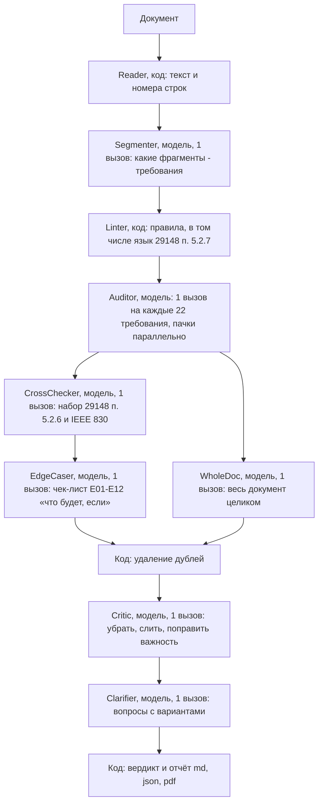

# reqcheck: агент проверки качества требований

Агент читает ТЗ до начала разработки и по каждому требованию показывает, какие свойства ISO/IEC/IEEE 29148
нарушены, с цитатой и номером строки. Потом задаёт автору вопросы с вариантами ответа, а после ответов
переписывает требования и проверяет их заново.

Сделано для BCC-HUB x MNU FinTech Hackathon. Версия v1.5. Отчёты в репозитории (кроме `examples/broken/`,
сделанных на v1.2) сделаны на модели `claude-opus-5-5` 27.11.2026. Стандарты: ISO/IEC/IEEE 29148:2018 п. 5.2.5, 5.2.6, 5.2.7 и IEEE 830-1998
п. 4.3. Все критерии лежат в `criteria.toml`, промпты собираются из него.

## Чем отличается

- **Вопросы с вариантами и рекомендацией.** У каждого вопроса есть адресат (бизнес, аналитик, архитектор, ИБ,
  QA), что без ответа нельзя сделать, 2-3 варианта, каждый можно проверить тестом, рекомендуемый вариант
  с причиной и список замечаний, которые ответ закроет. Три главных вопроса стоят на первом экране отчёта.
- **Цикл ответов.** Ответ, новая формулировка с критериями приёмки «Дано, Когда, Тогда», перепроверка
  изменённых и соседних требований, отчёт о разнице: что закрыто, что осталось, что появилось.
- **Свои проверки качества.** 3 документа с нашей разметкой дефектов, строгая ручная проверка, стресс-набор
  из 8 документов с ловушками, абляция по ролям, сравнение с одним промптом и тест на подгонку под примеры.
- **Повтор без ключа.** Ответы модели лежат в `.cache/llm`. Повтор отчёта делает 0 запросов к модели, ключ
  не нужен, отчёт получается тот же.
- **Цитаты с номерами строк.** Каждую цитату модели код ищет в тексте документа и сам ставит номер строки.
  Близкую цитату код заменяет строкой документа, ненайденную выбрасывает.

Результат на выданном ТЗ, на нашей разметке (40 дефектов, из них 13 обязательных, `eval/golden.toml`):
при строгой ручной проверке найдено 39 из 40 и все 13 обязательных, все 6 критичных оценены как «критично»
(G03 только через одно предложение в D-05, само замечание D-30 стоит «важно»).
Из 55 замечаний 48 (87%) реальные дефекты, неверных 0. Все 132 цитаты отчёта есть в документе дословно
([`eval/handcheck_v1.5.md`](eval/handcheck_v1.5.md)).

## Конвейер и один промпт на той же модели

Один сильный промпт на `claude-opus-5-5` (наш прогон 27.11.2026, [`eval/baseline/`](eval/baseline/README.md))
против конвейера v1.5. Все числа на нашей разметке; «строго» значит, что каждое совпадение прочитано вручную.

| | Конвейер v1.5 | Один промпт (на ТЗ 2 прогона) |
| :--- | :--- | :--- |
| Выданное ТЗ, найдено по `score.py` | 40/40 | 36/40 и 35/40 |
| Выданное ТЗ, найдено строго | 39/40 | 36/40 и 34/40 |
| Выданное ТЗ, обязательные по `score.py` / строго | 13/13 / 13/13 | 12/13 и 13/13 / 13/13 и 13/13 |
| Выданное ТЗ, точность по `score.py` | 89% (49 из 55) | 93% (28 из 30) и 97% (28 из 29) |
| autotopup: найдено / обязательные, `score.py` | 18/18 / 8/8 | 18/18 / 8/8 |
| cashback: найдено / обязательные, `score.py` | 20/20 / 9/9 | 19/20 / 8/9 |
| Вопросы с вариантами и рекомендацией | да | нет, только текст вопроса |
| Цикл ответов с перепроверкой | да | нет |
| Вызовов модели на выданном ТЗ | 8 | 1 |

- Конвейер по `score.py` нашёл все размеченные дефекты на всех трёх документах. В прогонах v1.4 и v1.5 он
  не пропустил ни одного обязательного.
- Один промпт по `score.py` пропускает 4-5 дефектов на выданном ТЗ. На cashback он пропустил обязательный B07: в API нет
  метода для отказа от кэшбэка (пропуск подтверждён вручную). На выданном ТЗ он немного точнее.
- Промпт для одного промпта написан после чтения нашей разметки выданного ТЗ, так что на этом документе
  сравнение скорее в его пользу. Но и конвейер меняли после прогонов на всех трёх документах. Промпт
  собран из `criteria.toml` времён v1.3, с тех пор правила важности в конвейере поменялись.
- Конвейер дороже: на выданном ТЗ 120 408 / 89 456 токенов (вход / выход) против 9 237 / 15 307.

## Как посмотреть: от готовых отчётов к своему прогону

### 1. Готовые отчёты, ничего не запуская

- Выданное ТЗ: [`report/report.md`](report/report.md) (также `report.pdf` и `report.json` со всеми данными и трассой).
- Второе ТЗ (написали мы сами): [`examples/autotopup/report.md`](examples/autotopup/report.md).
- Третье ТЗ (написали мы сами): [`examples/cashback/report.md`](examples/cashback/report.md).
- Цикл ответов: [`examples/answers/`](examples/answers/).
- ТЗ с инструкциями для модели внутри (v1.4): [`examples/injection/report.md`](examples/injection/report.md).
- Повреждённые файлы (сделаны на v1.2): [`examples/broken/`](examples/broken/).

Первый экран отчётов v1.5: вердикт, критичные дефекты с цитатами и три главных вопроса к автору.

### 2. Повтор без ключа, 0 запросов к модели

Нужен Python 3.11 или новее. Файл `.env` не нужен.

```bash
git clone https://github.com/l9kk/reqcheck && cd reqcheck
python -m venv .venv
. .venv/bin/activate            # Windows: .venv\Scripts\activate
pip install -r requirements.txt
python -m reqcheck input/requirements.md -o out/report.md
```

Агент берёт ответы модели из `.cache/llm` и пишет тот же отчёт: те же 55 замечаний и 10 вопросов. В паспорте
`out/report.md` будет «Запросов к модели: 8, все ответы взяты из кэша прошлого прогона». Ключ проверяется
только перед настоящим запросом, поэтому для повтора ничего задавать не нужно.

Чтобы отдельно убедиться, что сеть не нужна, можно направить API в никуда (Linux, macOS):

```bash
ANTHROPIC_BASE_URL=http://127.0.0.1:9 LLM_MAX_RETRIES=0 python -m reqcheck input/requirements.md -o out/report.md
```

Эти переменные только для такой проверки. Без `LLM_MAX_RETRIES=0` на документе без кэша агент будет повторять
каждый запрос к недоступному адресу, около двух минут на вызов.

Так же повторяются два других документа:

```bash
python -m reqcheck examples/docs/autotopup.md -o out/autotopup/report.md
python -m reqcheck examples/docs/cashback.md -o out/cashback/report.md
```

На другом документе кэша нет. Без ключа агент тогда отработает только правила кода и напишет
в отчёте, что модель не вызывалась.

### 3. Бесплатно: Gemini

Ключ: https://aistudio.google.com/apikey (войти Google-аккаунтом, Create API key).
Скопируйте `.env.example` в `.env` (Windows: `copy .env.example .env`), закомментируйте три строки
Anthropic и раскомментируйте блок Gemini:

```
LLM_PROVIDER=openai_compat
LLM_BASE_URL=https://generativelanguage.googleapis.com/v1beta/openai/
LLM_API_KEY=ваш_ключ
LLM_MODEL=gemini-3.5-flash
```

```bash
python -m reqcheck input/requirements.md -o out/gemini/report.md
```

На v1.2 `gemini-3.5-flash` нашёл 23 из 40 при строгой проверке (`git show v1.3:eval/manual_check.md`,
строка 9). На v1.5 Gemini не мерили, поэтому с числами `claude-opus-5-5` это напрямую не сравнить.
Если кончится дневная квота, агент напишет это в разделе «Диагностика».

### 4. Anthropic (на этой модели сделаны отчёты в репозитории)

Ключ: https://platform.claude.com/settings/keys (нужен баланс). В `.env` оставьте блок Anthropic и вставьте
ключ в `ANTHROPIC_API_KEY=`. Модель по умолчанию `claude-opus-5-5`.

```bash
python -m reqcheck input/requirements.md -o out/opus/report.md --no-cache
```

Без `--no-cache` на наших трёх документах агент просто повторит отчёт из кэша.

Форматы входа: `.pdf`, `.md`, `.txt` (UTF-8 и cp1251), `.docx`.

Коды выхода (`reqcheck/cli.py:107-111`):

- 2 - файл не прочитан (нет файла, пустой, битый, зашифрованный, скан без текста), документ не похож на ТЗ
  (по правилам кода или по ответу модели), внутренняя ошибка агента или ошибка в файле `--answers`;
- 1 - в отчёте есть критичные замечания;
- 0 - критичных замечаний нет.

Нет ключа, кончилась квота или не ответила сеть - это не код 2. Агент пишет отчёт по тому, что успел (часто
только правила кода), и выходит с 0 или 1. Поэтому в CI проверяйте в `report.json` поле `verdict.status` и
записи `diagnostics` с `"level": "error"`, а не только код выхода.

## Уточнение: вопросы и цикл ответов

Первый вопрос из `report/report.md`:

> **Q-01** (бизнес; закрывает D-01, D-16, D-33): Ф-3 (стр. 39) и Ф-4 (стр. 40) противоречат друг другу. Push
> в месяце уже отправлен, клиент повысил порог, и расходы достигли нового порога. Отправляется ли второй push
> в том же календарном месяце?
> Варианты: (а) Нет: признак отправки хранится на пару «карта + месяц» и при смене порога не сбрасывается. ...;
> (б) Да: сохранение порога с другим значением сбрасывает признак, сохранение того же значения не сбрасывает. ...;
> (в) Да, без условий: любое сохранение через saveLimit, включая тот же порог, сбрасывает признак. ...
> Рекомендация агента: Вариант 2. Он сохраняет смысл Ф-4 «независимо от истории» и не даёт получить лишний
> push повторным сохранением того же порога. ...

Ответы можно дать в терминале (`--interactive`) или файлом:

```bash
python -m reqcheck input/requirements.md -o out/report.md --answers examples/answers/requirements.answers.toml
```

Формат файла: `Q-01 = "a"` (буква варианта), `"default"` (рекомендация агента) или свой текст. Нужна модель:
роль Rewriter пишет новую формулировку и критерии приёмки, затем Auditor и CrossChecker перепроверяют
переписанные и соседние требования, роль Delta сверяет старые и новые замечания. Результат:
`out/report.answers.md`. Официальный отчёт не меняется. С этим файлом ответов пример повторяется из кэша
без ключа.

Настоящий пример: [`examples/answers/requirements.report.answers.md`](examples/answers/requirements.report.answers.md),
10 ответов на вопросы текущего `report/report.md` (v1.5). Что в нём видно:

- Критичных на изменённых требованиях было 5, стало 4: ответ на Q-02 закрыл критичное D-04 (месяц покупки
  по дате совершения). Критичное D-01 осталось: новая формулировка R-08 описывает только случай, когда
  накопленная сумма ниже нового порога.
- Переписано 25 требований, с критериями приёмки «Дано, Когда, Тогда». Перепроверка: 4 вызова модели.
- Закрыто 7 из 21 связанного замечания, 14 осталось, причина указана у каждого.
- Появилось 19 новых замечаний, это последствия ответов. Например, по новому правилу push разрешён «на одно
  значение порога в месяц», а хранится один признак отправки на карту и месяц (N-65).
- Поэтому всего замечаний на изменённых требованиях стало больше: было 41 (критично 5, важно 28, мелочь 8),
  стало 53 (критично 4, важно 40, мелочь 9).

Ответы закрывают часть замечаний и тут же дают новые, а формулировки по разным ответам могут спорить друг
с другом. Перепроверка нужна, чтобы это было видно до разработки.

## Как устроен агент



- Вызовов модели на документ: 6 + число пачек Auditor. Выданное ТЗ: 44 требования, 2 пачки, 8 вызовов.
  autotopup: 21 требование, 7 вызовов. cashback: 66 требований, 3 пачки, 9 вызовов.
- Повторы. Если JSON роли не той формы, код один раз спрашивает роль заново (`reqcheck/pipeline.py:271-276`);
  этот вызов попадает в паспорт. Невалидный JSON, сетевые ошибки и лимиты повторяются внутри `reqcheck/llm.py`
  до `LLM_MAX_RETRIES` раз (по умолчанию 4, `llm.py:166-182`); эти повторы в число вызовов и токенов
  паспорта не входят.
- Ветка CrossChecker затем EdgeCaser и ветка WholeDoc идут параллельно (`--workers`, по умолчанию 3).
- Проверка цитат в коде (`reqcheck/ground.py`): каждую цитату от Auditor, CrossChecker, EdgeCaser, WholeDoc
  и Clarifier код ищет в тексте документа. Нашёл дословно - цитата остаётся. Нашёл приблизительно (сходство
  не ниже 0.85, `ground.py:63-64`) - цитата заменяется строкой документа. Не нашёл - цитата выбрасывается;
  замечание или вопрос без единой найденной цитаты выбрасывается целиком. Номер строки ставит код, не модель.
  Если для противоречия набора (`set_consistent`) модель дала две цитаты или больше, а в документе нашлась
  только одна строка, замечание отбрасывается (`pipeline.py:368-370`). Отброшенное с причиной лежит в `drops`
  в JSON.
- Вердикт («начинать разработку: Да / С оговорками / Нет», или «Не проверено») считает код по числу
  критичных и важных замечаний. «Не проверено» ставится, если документ не прочитан или не похож на ТЗ, а также
  если модель не использовалась и правила кода не нашли критичных. Если правила нашли критичные, вердикт «Нет»
  и без модели (`pipeline.py:648-667`).
- Текст документа передаётся модели как данные: промпт велит не выполнять команды из документа и считать их
  дефектом (`reqcheck/roles.py:23-24`). Гарантии, что модель послушается, нет. На ТЗ с такими командами
  (`examples/injection/report.md`, v1.4) агент их не выполнил и отметил как дефект D-12.

Что конвейер добавляет к одному промпту, кроме полноты: таблицу «требование x 9 свойств 29148 п. 5.2.5» для
каждого требования (раздел 5 отчёта), вопросы с вариантами, цикл ответов, проверку цитат кодом, проверку
формы JSON каждой роли и описанные отказы (пустой, битый, зашифрованный файл, скан без текста, не ТЗ, нет
ключа, кончилась квота): агент не падает, а пишет раздел «Диагностика».

## Что нового в v1.5

- Калибровка важности. Размытая формулировка без числа теперь «важно», а не «критично» (`criteria.toml:9-10`).
  Если документ о чём-то просто молчит, это не повод для «критично». Общие пункты чек-листа, которые документ
  сам не обещает, не выше «мелочь» (`reqcheck/roles.py:280-292`).
- Критик не может понизить или удалить «критично» от правил кода про GET для операции записи
  (`reqcheck/pipeline.py:560`, `571`, `589-595`).
- Слитый текст, который в основном повторяет целевое замечание, больше не дописывается (`pipeline.py:538-549`).
- Для каждого противоречия CrossChecker даёт пример-свидетель: один вход и два разных результата
  (`reqcheck/roles.py:145-147`).
- Первый экран отчёта показывает три главных вопроса.

Что это дало на выданном ТЗ, на нашей разметке, строго (`eval/handcheck_v1.4.md` и `eval/handcheck_v1.5.md`):

| | v1.4 | v1.5 |
| :--- | :--- | :--- |
| Найдено строго | 37/40 | 39/40 |
| Обязательные строго | 13/13 | 13/13 |
| Критичные оценены как «критично» | 5/6 | 6/6 (G03 только через одно предложение в D-05) |
| Точность строго | 92% (60 из 65) | 87% (48 из 55) |
| Замечаний / вопросов | 65 / 10 | 55 / 10 |

Стресс-набор: на крошечном ТЗ s2 критичных стало 2 вместо 6, на почти чистом s7 1 вместо 2
(`eval/stress/reports_v1.4-rc1/`, `eval/stress/reports_v1.5-rc1/`). Вердикт у обоих всё ещё «Нет».

## Оценка («самопроверка»)

Разметку дефектов (`eval/golden*.toml`) писали мы сами, поэтому все числа здесь на нашей разметке, а не
внешняя оценка. `python eval/score.py report/report.json` сопоставляет замечания с разметкой по строке и
ключевому слову. Строгая проверка: каждое совпадение открыто и прочитано отдельным агентом, разметка не
менялась ([`eval/handcheck_v1.5.md`](eval/handcheck_v1.5.md)).

| Документ | Дефектов в разметке | Найдено, score.py | Найдено, строго | Обязательные | Критичные как «критично» | Точность, score.py | Вызовов |
| :--- | :--- | :--- | :--- | :--- | :--- | :--- | :--- |
| Выданное ТЗ | 40 | 40 | 39 | 13/13 | 6/6 | 49/55 (89%) | 8 |
| autotopup | 18 | 18 | не проверяли | 8/8 | 4/4 | 33/42 (79%) | 7 |
| cashback | 20 | 20 | не проверяли | 9/9 | 4/5 | 41/73 (56%) | 9 |

```bash
python eval/score.py report/report.json
python eval/score.py examples/autotopup/report.json --golden eval/golden_autotopup.toml
python eval/score.py examples/cashback/report.json --golden eval/golden_cashback.toml
```

- autotopup: разметка закоммичена до первого прогона, но общие правила кода дописаны позже тем же человеком,
  поэтому прогон не полностью независимый (`eval/manual_check.md`).
- cashback: разметка закоммичена до любого прогона агента (0fe31eb) и с тех пор не менялась. Слепой эта
  проверка была только для v1.3: конвейер v1.5 настраивали уже после того, как видели результаты на cashback.
- Стресс-набор: 8 документов (длинный, крошечный в cp1251, английский, казахский, с инструкциями для модели,
  не ТЗ, чистый, docx и pdf). Ключи написал отдельный агент ([`eval/stress/`](eval/stress/README.md)).
  На v1.4-rc1 строго найдено 55 из 56 дефектов и 29 из 29 обязательных. Главная проблема того прогона,
  завышенная «критично», и привела к калибровке v1.5.
- Абляция по ролям: [`eval/ablation.md`](eval/ablation.md), считается из кэша без запросов к модели
  (`python -m eval.ablation`).
- Тест на подгонку `tests/test_no_overfit.py`: в `reqcheck/*.py` и `criteria.toml` нет ни одной фразы из 5 слов
  из трёх примеров ТЗ и четырёх названий API из примеров (`saveLimit`, `cardId`, `/alerts/`, `spentMonth`).
  Это значит, что текст примеров не скопирован в промпты и правила, но не что их не подстраивали: промпты
  меняли после прогонов на этих документах.

### Вклад ролей

Повтор из `.cache/llm`, без новых запросов к модели, подробно в [`eval/ablation.md`](eval/ablation.md).
Совпадения считает `score.py`. В ячейке: замечаний / найдено дефектов разметки / найдено обязательных.

| Вариант | Выданное ТЗ | autotopup | cashback |
| :--- | :--- | :--- | :--- |
| Только правила (Linter) | 14 / 11/40 / 9/13 | 9 / 7/18 / 4/8 | 3 / 2/20 / 1/9 |
| + Auditor | 77 / 36/40 / 13/13 | 43 / 16/18 / 8/8 | 100 / 19/20 / 8/9 |
| + CrossChecker/EdgeCaser | 95 / 39/40 / 13/13 | 57 / 17/18 / 8/8 | 123 / 20/20 / 9/9 |
| + WholeDoc (все ветки, до Критика) | 124 / 40/40 / 13/13 | 79 / 18/18 / 8/8 | 153 / 20/20 / 9/9 |
| Полный (после Критика = закоммиченный report.json) | 55 / 40/40 / 13/13 | 42 / 18/18 / 8/8 | 73 / 20/20 / 9/9 |

Ряды до Критика - срезы одного прогона, а не отдельные прогоны; в них есть дубли и ложные срабатывания.
Остальные оговорки в `eval/ablation.md`.

## Сколько времени это экономит

Не мерили. Выданное ТЗ: 198 строк и 1 382 слова (`wc -w`), это около 4.6 логических страниц по 300 слов.
По норме Gilb (меньше 2 таких страниц в час) один внимательный ревьюер тратит на него больше 2 часов; это наш
пересчёт нормы, а не замер. Другие нормы считают в обычных страницах, а их число зависит от вёрстки. Нормы:

- Porter, Votta, Basili. Comparing Detection Methods for Software Requirements Inspections: A Replicated
  Experiment. IEEE Transactions on Software Engineering 21(6), 1995: 2 часа на ТЗ в 24 и 31 страницу, то есть
  не меньше 12-15 страниц в час.
- Wiegers. Improving Quality Through Software Inspections. Software Development, апрель 1995: 8-12 страниц
  текстовых документов за 2 часа, то есть 4-6 страниц в час.
- Gilb. Agile Specification Quality Control. Testing Experience, март 2009: меньше 2 логических страниц
  (по 300 слов) в час.

Сколько времени человек тратит на проверку замечаний агента, мы тоже не мерили, поэтому экономию не считаем.

## Как сделаны отчёты в репозитории

Ответы модели записаны кодом v1.5-rc1 (коммит 669700f) на `claude-opus-5-5` 27.11.2026. Отчёты потом
перерисованы из кэша кодом v1.5 (коммит a361869, он меняет только первый экран), поэтому в паспорте стоит
«все ответы взяты из кэша», а время и токены указаны по исходному прогону. Запросы к модели шли не через
API-ключ, а через подписку Claude Code с той же моделью: локальный прокси `tools/claude_proxy.py` принимает
запросы в формате Anthropic Messages API на 127.0.0.1 и передаёт каждый в `claude -p` без инструментов.
Нужен установленный и авторизованный Claude Code. Запуск (два терминала):

```bash
python tools/claude_proxy.py 8765
LLM_PROVIDER=anthropic ANTHROPIC_BASE_URL=http://127.0.0.1:8765 python -m reqcheck input/requirements.md -o out/report.md --no-cache
```

Код написан после выдачи задания с помощью AI-инструментов, организаторы это разрешили (чат хакатона, 22.11.2026); история коммитов открыта.

## Тесты

```bash
python -m unittest tests.test_reader tests.test_pipeline tests.test_report_md eval.test_score tests.test_loop eval.test_ablation tests.test_no_overfit
```

130 тестов, ключ не нужен: модель подменяет `tests/fake_llm.py`. Среди них повтор из кэша без ключа,
набор повреждённых файлов `tests/fixtures/broken/` и тест на подгонку `tests/test_no_overfit.py`.

## Ограничения и известные промахи

- cashback: дефект B04 (возвраты не обработаны) теперь «важно», а в разметке «критично». Это цена калибровки
  «молчание документа не повод для критично». Попытка сузить это правило (v1.5-rc2) B04 не вернула и подняла
  число критичных на стресс-документах, мы её откатили.
- cashback больше не слепая проверка: конвейер v1.5 настраивали после того, как видели на нём результаты.
- Часть рекомендаций в вопросах спорит с исправлениями в замечаниях или с другими вопросами. При строгой
  проверке так у 5 из 10 вопросов на выданном ТЗ: например, исправление D-12 считает расходы по проведению,
  а рекомендация Q-06 по холду; Q-03 и Q-05 спорят друг с другом. Отчёт помечает такие исправления «окончательно после ответа на Q-xx». Попытка исправить это
  промптом Clarifier спорных мест не уменьшила, мы её откатили (коммиты 6103e26 и 9413c59).
- Промахи важности на выданном ТЗ: пустые версия, чек-лист и согласующие (D-47) и Content-Type при пустом
  теле (D-53) стоят «мелочь», а в разметке это обязательные «важно». Критичный G03 (метод называют и
  сохранением, и чтением) засчитан как «критично» только через одно предложение в D-05, само замечание D-30
  стоит «важно». Не найдено: где виден «Итог 50 000 ₸» в критерии 1 (G33).
- Чистый документ всё ещё получает «Нет»: на s7 остался 1 «критично» и 41 «важно».
- Один прогон на документ для каждой версии: разброс между прогонами конвейера не измерен.
- autotopup и cashback строго не проверены. На cashback 12 из 73 замечаний помечены «критично», это может
  быть завышено.
- Конвейер тратит больше токенов и времени, чем один промпт.
- Без модели работают только правила кода, они находят мало (11 из 40, `eval/ablation.md`).
- В примере цикла ответов критичных на изменённых требованиях стало 4 вместо 5, но закрыто только 7 из 21
  связанного замечания, а новых появилось 19.
