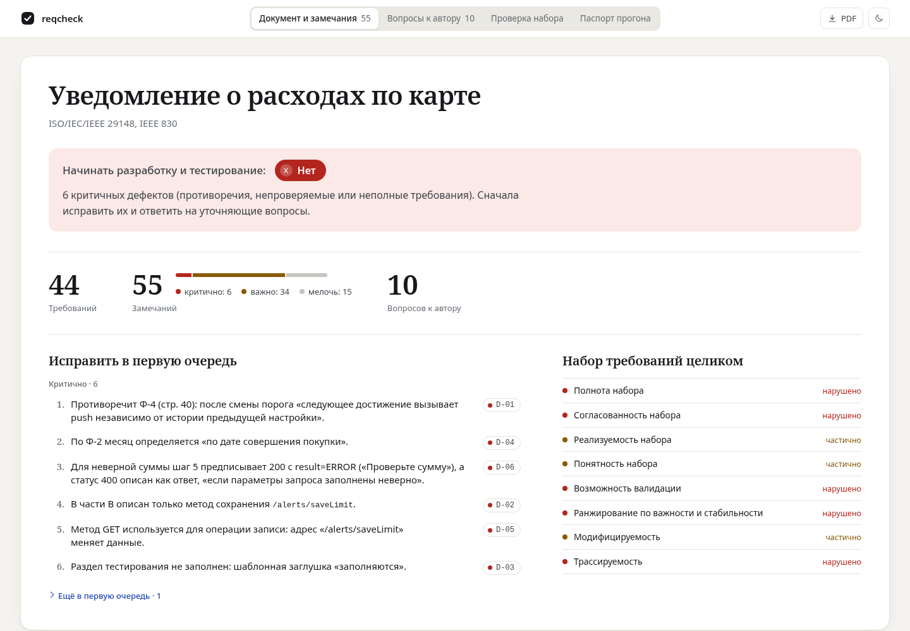

# reqcheck: проверка ТЗ до разработки

Агент читает ТЗ, находит дефекты требований по ISO/IEC/IEEE 29148 и IEEE 830, задаёт автору вопросы
с вариантами ответа и пишет отчёт на русском. Для QA-лида и аналитика: дефекты видны до того, как по ТЗ
начнут писать код и тесты. Каждое замечание с дословной цитатой и номером строки, цитаты проверяет код.

**Для жюри:** [отчёт в браузере](https://htmlpreview.github.io/?https://github.com/l9kk/reqcheck/blob/main/report/report.html) ·
[отчёт PDF](report/report.pdf) · [презентация](docs/deck.pdf) · [все числа и команды](RESULTS.md) · [вопросы и ответы](docs/qa.md)

| На выданном ТЗ | |
| :--- | :--- |
| Дефекты из нашего списка (40 штук, составили сами) | **40 из 40**, все 6 критичных отмечены как критичные |
| Вопросы автору | **10**, у каждого адресат, варианты ответа и рекомендация |
| Время и цена прогона | **14 минут, около 1 110 ₸**; инспекция командой 3-4 человек: 2.3-4.6 ч, 8 000-15 900 ₸ |
| Новое ТЗ, которое мы разметили до первого прогона | 20 из 20 |

Отчёт сделан настоящим прогоном агента 27.11: 9 вызовов модели, 14 минут. Ответы модели сохранены в
`.cache/llm`, поэтому в паспорте отчёта стоит «из кэша», а `--replay` повторяет тот же отчёт без ключа.

Данные: текст ТЗ уходит только в модель Claude (Anthropic). Для банка тот же агент без правки кода
подключается к модели внутри контура банка через OpenAI-совместимый адрес (`.env.example`); качество на
такой модели мы не замеряли.



*Отчёт в браузере: слева ТЗ с номерами строк, справа замечания; клик по замечанию подсвечивает его цитату. Агент пишет его рядом с `.md`, `.pdf` и `.json`.*

## Почему такая архитектура

Модель предлагает, код решает. Роли на модели находят дефекты и пишут вопросы. Всё, что можно проверить
без модели, проверяет код, и ни одно решение модели не попадает в отчёт без этой проверки.

| Что проверяет код | Где | Что это даёт |
| :--- | :--- | :--- |
| Ищет каждую цитату в ТЗ и сам ставит номер строки. Цитата не найдена: замечание выброшено | `reqcheck/ground.py:34-80`, `reqcheck/pipeline.py:380-404` | 132 цитаты в отчёте, все дословные |
| Форму JSON каждой роли. Не та форма: один повторный запрос, потом роль пропускается | `reqcheck/roles.py:418-446`, `reqcheck/pipeline.py:294-306` | одна сломанная роль не ломает отчёт |
| Границы ролей: Critic не может удалить найденный кодом GET для записи, Reconciler меняет только текст исправления | `reqcheck/pipeline.py:585-619`, `676-729` | роль не выходит за свою задачу |
| Вердикт «Да / Нет» считает код по числу критичных | `reqcheck/pipeline.py:746-767` | текст внутри ТЗ не поставит «Да» |
| Всё отброшенное пишет в `drops` с причиной | `report/report.json` | видно, что и почему отсеяно |

Каждая роль оправдана замером на выданном ТЗ (повтор из кэша, `python -m eval.ablation`, [`eval/ablation.md`](eval/ablation.md)):

| Шаг | Найдено из 40 | Замечаний |
| :--- | :--- | :--- |
| Только правила кода | 11 | 14 |
| + Auditor: каждое требование по 9 свойствам 29148 | 36 | 77 |
| + CrossChecker и EdgeCaser: набор целиком и «что будет, если» | 39 | 95 |
| + WholeDoc: весь документ одним взглядом | 40 | 124 |
| + Critic: убрать дубли и шум | 40 | 55 |
| Один сильный промпт на той же модели | 36 | 30 |

Критерии 29148 и IEEE 830 лежат в `criteria.toml`: свой стандарт банка добавляется правкой данных, а не кода.
Схема ролей: [«Как работает»](#как-работает).

## Результат на выданном ТЗ

Отчёт сверен с нашим списком из 40 дефектов выданного ТЗ ([`eval/golden.toml`](eval/golden.toml)).
Для строгой проверки отдельный агент-проверяющий открыл и прочитал каждое совпадение.

| Что проверяли | Результат |
| :--- | :--- |
| Найдено дефектов из нашего списка | **40 из 40** автоматической сверкой, 39 при строгой проверке |
| Критичные дефекты | все 6 распознаны как критичные |
| Замечания агента, которые оказались реальными дефектами | 48 из 55 (87%), ложных 0 |
| Цитаты в отчёте | 132, все дословные |
| Один промпт на той же модели (Claude Opus), 2 прогона | 36 и 34 из 40 при строгой проверке |

Слепая проверка: ТЗ cashback мы разметили раньше любого прогона агента на нём (разметка в git 26.11 в 02:10,
коммит 0fe31eb). Первый полный прогон (v1.3, 27.11 в 03:29, коммит 80e6f66) нашёл 20 из 20 при строгой проверке
([`eval/manual_check.md`](eval/manual_check.md)).

Метод и все числа: [`eval/handcheck_v1.5.md`](eval/handcheck_v1.5.md),
[`docs/details.md`](docs/details.md#результат-подробно).

## Ценность

| | Оценка |
| :--- | :--- |
| Инспекция ТЗ на 1 382 слова командой из 3-4 ревьюеров (нормы Wiegers 1995, команда по Fagan 1976) | 2.3-4.6 ч на всю команду, 8 000-15 900 ₸ |
| Прогон агента на Claude | 14 минут, около 1 110 ₸ ($2.42 по курсу НБ РК 458.85 на 27.11.2026) |
| Чтение отчёта человеком (допущение) | 20-30 минут, 1 150-1 730 ₸ |
| Дефект требований, найденный только на тестах | в 21-78 раз дороже, чем на этапе требований (NASA, 2004) |

Агент ловит дефекты до разработки, когда они дешевле всего: на выданном ТЗ все 6 критичных.
Расчёт и источники: [`docs/details.md`](docs/details.md#ценность-в-тенге).

## Что получает QA-лид

Замечаний 55, но читать начинают с 6 критичных: они на первом экране отчёта, а в `report.html` фильтр
«критично» включён по умолчанию.

Критичный дефект из [`report/report.md`](report/report.md). «Корректное» - свойство требования по
ISO 29148 п. 5.2.5, Ф-3 и Ф-4 - пункты самого ТЗ.

> **D-01** (Корректное, вопрос Q-01): Противоречит Ф-4 (стр. 40): после смены порога «следующее достижение
> вызывает push независимо от истории предыдущей настройки». Если push уже отправлен, а клиент поднял порог,
> по Ф-4 будет второй push в месяце, что запрещено Ф-3.
> > «На карту приходится максимум один такой push за календарный месяц» (строка 39)
> >
> > «следующее достижение вызывает push независимо от истории предыдущей настройки» (строка 40)
>
> Последствия: Нельзя определить ожидаемый результат для сценария «push отправлен → порог повышен → новое
> достижение». Требования взаимоисключающие.

И вопрос к автору, который закрывает этот дефект. У каждого вопроса есть адресат, варианты
и рекомендация; у 7 из 10 вопросов к вариантам приложен тест.

> **Q-01** (бизнес; закрывает D-01, D-16, D-33): Ф-3 (стр. 39) и Ф-4 (стр. 40) противоречат друг другу.
> Push в месяце уже отправлен, клиент повысил порог, и расходы достигли нового порога. Отправляется ли
> второй push в том же календарном месяце?
>
> - (а) Нет: признак отправки хранится на пару «карта + месяц» и при смене порога не сбрасывается. Тест:
>   push 10.01 при пороге 50 000 ₸, порог изменён на 80 000 ₸, расходы дошли до 80 000 ₸, второго push в январе нет.
> - (б) Да: сохранение порога с другим значением сбрасывает признак, сохранение того же значения не
>   сбрасывает. Если накопленная сумма уже ≥ нового порога, push не отправляется до следующего месяца.
>   Тест: тот же сценарий даёт второй push в январе при 80 000 ₸.
> - (в) Да, без условий: любое сохранение через saveLimit, включая тот же порог, сбрасывает признак.
>   Тест: повторное сохранение 50 000 ₸ и следующая покупка дают второй push.
>
> Рекомендация агента: Вариант (б). Он сохраняет смысл Ф-4 «независимо от истории» и не даёт получить
> лишний push повторным сохранением того же порога. Ф-3 нужно переформулировать как «один push на
> значение порога в месяц».

Всего в отчёте 55 замечаний, 132 цитаты и 10 вопросов, три главных вопроса стоят на первом экране.

Пограничные случаи, которых нет в тексте ТЗ, агент нашёл сам:

- покупка 31.01 в 23:58 проведена 01.02 в 00:03: в какой месяц она попадает (D-04, Q-02);
- второй push в том же месяце после повышения порога (D-01, Q-01);
- повторное сохранение того же порога сбрасывает признак отправки (Q-01, вариант в).

Вопрос не попадает в отчёт, если ответ уже есть в ТЗ: модель приводит цитату-ответ, код находит её в
документе и снимает вопрос (`reqcheck/pipeline.py:640-643`).

## Быстрый старт


Повтор нашего прогона без ключа: ответы модели из кэша `.cache/llm`, 0 запросов. Нужен Python 3.11+.

```bash
git clone https://github.com/l9kk/reqcheck && cd reqcheck
python -m venv .venv && . .venv/bin/activate && pip install -r requirements.txt   # Windows: .venv\Scripts\activate
python -m reqcheck input/requirements.md -o out/report.md --replay
```

Отчёт ляжет в `out/report.md`, рядом `out/report.pdf`, `out/report.html` и `out/report.json`.

Свой прогон с ключом. Скопируйте `.env.example` в `.env` (ключ кладётся туда, в git `.env` не попадает).

- **Anthropic.** Ключ: https://platform.claude.com/settings/keys (нужен баланс). Вставьте его
  в `ANTHROPIC_API_KEY=`. Модель по умолчанию `claude-opus-5-5`. Без `--no-cache` агент повторит отчёт из кэша.
  Запуск: `python -m reqcheck input/requirements.md -o out/opus/report.md --no-cache`
- **Подписка Claude Code вместо ключа.** Локальный прокси `tools/claude_proxy.py` передаёт запросы в `claude -p`,
  наши отчёты сделаны так. [Как запустить](docs/details.md#два-способа-подключить-claude).

В процессе команды: агент ставится шагом перед разработкой. Код выхода 0 - критичных нет, 1 - есть критичные
(вердикт «Нет»), 2 - документ не прочитан или это не ТЗ. Вердикт, замечания и вопросы лежат в `report.json`.

На входе `.pdf`, `.docx`, `.xlsx`, `.html`, `.md` или `.txt`. Другие провайдеры, коды выхода и проверка без сети:
[`docs/details.md`](docs/details.md#как-посмотреть-от-готовых-отчётов-к-своему-прогону).

## Как работает


Роли с пометкой «код» работают без модели. На выданном ТЗ 9 вызовов модели.

- **Цитаты проверяет код.** Каждую цитату модели код ищет в тексте ТЗ и сам ставит номер строки. Не нашёл -
  цитата выброшена, замечание без цитат тоже (`reqcheck/ground.py`).
- **Критерии - это данные.** Свойства 29148 и IEEE 830 лежат в `criteria.toml`, промпты собираются из него.
- **Проверка формы ответа.** Если JSON роли не той формы, код один раз спрашивает роль заново
  (`reqcheck/pipeline.py:294-306`). Вердикт считает код, а не модель.
- **Reconciler.** Сверяет исправления в замечаниях с рекомендациями вопросов: противоречий было 4-8 из 10
  вопросов, стало 2 из 10, и они помечены в отчёте «Внимание» ([`eval/reconciler_check.md`](eval/reconciler_check.md)).
- **Кэш.** Каждый ответ модели сохраняется в `.cache/llm`, повтор того же прогона не тратит запросов.

Конвейер против одного сильного промпта на той же модели, выданное ТЗ:

| | Конвейер | Один промпт, 2 прогона |
| :--- | :--- | :--- |
| Найдено из 40, автоматически / строго | 40 / 39 | 36 и 35 / 36 и 34 |
| Критичные распознаны как критичные | 6 из 6 в каждом из 3 прогонов | 5 из 6 и 6 из 6 |
| Цитаты и номера строк проверяет код | да | нет |
| Вопросы с вариантами и рекомендацией | да | нет, только текст вопроса |
| Цикл ответов с перепроверкой | да | нет |
| Вызовов модели, цена по токенам | 9, около $2.4 | 1, $0.34 и $0.26 |

Один промпт дешевле и быстрее. Его писали, уже зная наш список дефектов выданного ТЗ, и он всё равно
нашёл меньше. На ТЗ cashback, которое оба видели впервые, он пропустил обязательный дефект, первый прогон конвейера
нашёл 20 из 20. Это один документ, поэтому главное сравнение - на выданном ТЗ ([`eval/baseline/`](eval/baseline/README.md)).

## Цикл ответов

Ответы даются файлом (`--answers`) или в терминале (`--interactive`). [Пример на 10 ответах](examples/answers/requirements.report.answers.md):

- Ответы закрыли 3 из 5 критичных (D-04, D-05, D-06) и 8 из 21 связанного замечания.
- Перепроверка поймала 13 новых проблем, которые внесли сами ответы, среди них критичное N-70. Их видно
  до разработки, а не на тестах.
- Переписано 25 требований, перепроверка заняла 4 вызова модели.

## Подробнее

- Как мы считали и что учесть: [`RESULTS.md`](RESULTS.md#как-мы-считали).
- Все детали, запуск, тесты: [`docs/details.md`](docs/details.md). Оценка: [`eval/`](eval/).
- Отчёт на выданном ТЗ: [`report/report.md`](report/report.md), [`report.pdf`](report/report.pdf), [`report.json`](report/report.json).
- Вопросы жюри и ответы: [`docs/qa.md`](docs/qa.md).
- Одностраничник: [`docs/onepager.pdf`](docs/onepager.pdf). Презентация: [`docs/deck.pdf`](docs/deck.pdf).
- Ещё отчёты: [`examples/`](examples/) (два наших ТЗ, битые файлы, ТЗ с инструкциями для модели).
