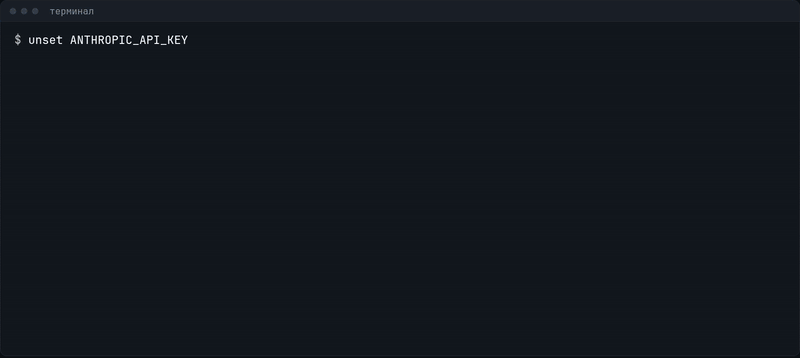
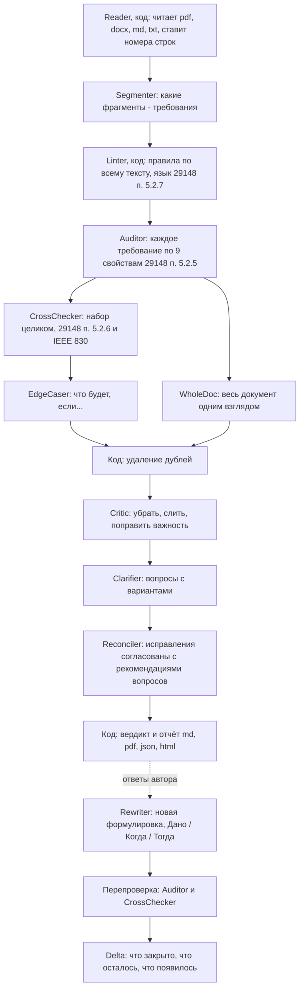

# reqcheck: проверка ТЗ до разработки

Агент читает ТЗ, находит дефекты требований по ISO/IEC/IEEE 29148 и IEEE 830, задаёт автору вопросы
с вариантами ответа и пишет отчёт на русском. Для QA-лида и аналитика: дефекты видны до того, как по ТЗ
начнут писать код и тесты. Каждое замечание с цитатой и номером строки.

**Проверить за 2 минуты:** все числа и команды для их проверки в [`RESULTS.md`](RESULTS.md); отчёт на выданном ТЗ [`report/report.md`](report/report.md) (или [PDF](report/report.pdf)),
презентация [`docs/deck.pdf`](docs/deck.pdf), одностраничник [`docs/onepager.pdf`](docs/onepager.pdf).


*Отчёт открывается в браузере: слева ТЗ с номерами строк, справа замечания; клик по замечанию подсвечивает его цитату. Файл [`report/report.html`](report/report.html), [открыть в браузере](https://htmlpreview.github.io/?https://github.com/l9kk/reqcheck/blob/main/report/report.html). Агент пишет его рядом с `.md`, `.pdf` и `.json`.*

## Результат на выданном ТЗ

Мы сами составили список из 40 дефектов выданного ТЗ и сверили с ним отчёт агента. Каждое совпадение
открыл и прочитал отдельный агент-проверяющий (не человек), не только автоматическая сверка.

| Что проверяли | Результат |
| :--- | :--- |
| Найдено дефектов из нашего списка | **40 из 40** автоматической сверкой, 39 при строгой проверке |
| Критичные дефекты | все 6 распознаны как критичные |
| Замечания агента, которые оказались реальными дефектами | 48 из 55 (87%), ложных 0 |
| Один промпт на той же модели (Claude Opus), 2 прогона | 36 и 34 из 40 |

Ещё одно ТЗ (cashback) мы написали с разметкой до первого прогона: разметка в git 26.11 в 02:10
(коммит 0fe31eb), первый отчёт по нему 27.11 в 03:29 (коммит 80e6f66). Тот первый прогон нашёл 20 из 20
при строгой проверке ([`eval/manual_check.md`](eval/manual_check.md)); v1.5 и v1.6 настраивали уже после этого.

Метод и все числа: [`eval/handcheck_v1.5.md`](eval/handcheck_v1.5.md),
[`docs/details.md`](docs/details.md#результат-подробно).

## Ценность

Агент ловит дефекты до разработки: на выданном ТЗ все 6 критичных из нашего списка.

| Ценность | Оценка по нормам |
| :--- | :--- |
| Инспекция ТЗ на 1 382 слова командой из 3-4 ревьюеров | 2.3-4.6 чел.-часа, 8 000-15 900 ₸ |
| Прогон агента на Claude | 14 минут, около 1 110 ₸ ($2.42 по курсу НБ РК 458.85 на 27.11.2026) |
| Дефект требований, найденный только на тестах | в 21-78 раз дороже, чем на этапе требований (NASA, 2004) |

Расчёт и источники: [`docs/details.md`](docs/details.md#ценность-в-тенге).

## Что получает QA-лид

Критичный дефект из [`report/report.md`](report/report.md). «Корректное» - свойство требования по
ISO 29148 п. 5.2.5, Ф-3 и Ф-4 - пункты самого ТЗ.

> **D-01** (Корректное, вопрос Q-01): Противоречит Ф-4 (стр. 40): после смены порога «следующее достижение
> вызывает push независимо от истории предыдущей настройки». Если push уже отправлен, а клиент поднял порог,
> по Ф-4 будет второй push в месяце, что запрещено Ф-3.
> > «На карту приходится максимум один такой push за календарный месяц» (строка 39)
> >
> > «следующее достижение вызывает push независимо от истории предыдущей настройки» (строка 40)
>
> Последствия: Нельзя определить ожидаемый результат для сценария «push отправлен → порог повышен → новое
> достижение». Требования взаимоисключающие.

И вопрос к автору, который закрывает этот дефект. У каждого вопроса есть адресат, варианты
и рекомендация; у 7 из 10 вопросов к вариантам приложен тест.

> **Q-01** (бизнес; закрывает D-01, D-16, D-33): Ф-3 (стр. 39) и Ф-4 (стр. 40) противоречат друг другу.
> Push в месяце уже отправлен, клиент повысил порог, и расходы достигли нового порога. Отправляется ли
> второй push в том же календарном месяце?
>
> - (а) Нет: признак отправки хранится на пару «карта + месяц» и при смене порога не сбрасывается. Тест:
>   push 10.01 при пороге 50 000 ₸, порог изменён на 80 000 ₸, расходы дошли до 80 000 ₸, второго push в январе нет.
> - (б) Да: сохранение порога с другим значением сбрасывает признак, сохранение того же значения не
>   сбрасывает. Если накопленная сумма уже ≥ нового порога, push не отправляется до следующего месяца.
>   Тест: тот же сценарий даёт второй push в январе при 80 000 ₸.
> - (в) Да, без условий: любое сохранение через saveLimit, включая тот же порог, сбрасывает признак.
>   Тест: повторное сохранение 50 000 ₸ и следующая покупка дают второй push.
>
> Рекомендация агента: Вариант (б). Он сохраняет смысл Ф-4 «независимо от истории» и не даёт получить
> лишний push повторным сохранением того же порога. Ф-3 нужно переформулировать как «один push на
> значение порога в месяц».

Всего в отчёте 55 замечаний, 132 цитаты и 10 вопросов, три главных вопроса стоят на первом экране.

## Быстрый старт



Повтор нашего прогона без ключа: ответы модели из кэша `.cache/llm`, 0 запросов. Нужен Python 3.11+.

```bash
git clone https://github.com/l9kk/reqcheck && cd reqcheck
python -m venv .venv && . .venv/bin/activate && pip install -r requirements.txt   # Windows: .venv\Scripts\activate
python -m reqcheck input/requirements.md -o out/report.md
```

Отчёт ляжет в `out/report.md`, рядом `out/report.pdf` и `out/report.json`.

Свой прогон с ключом. Скопируйте `.env.example` в `.env` (ключ кладётся туда, в git `.env` не попадает).

- **Бесплатно, Gemini.** Ключ: https://aistudio.google.com/apikey (Create API key). В `.env` закомментируйте
  три строки Anthropic, раскомментируйте блок Gemini и вставьте ключ в `LLM_API_KEY=`. Модель `gemini-3.5-flash`.
  Запуск: `python -m reqcheck input/requirements.md -o out/gemini/report.md`
  Только для пробы на открытых документах: условия Google запрещают отправлять на бесплатный уровень конфиденциальные данные, запросы могут читать люди (aistudio.google.com/docs/terms, действуют с 23.03.2026).
- **Anthropic.** Ключ: https://platform.claude.com/settings/keys (нужен баланс). Вставьте его
  в `ANTHROPIC_API_KEY=`. Модель по умолчанию `claude-opus-5-5`. Без `--no-cache` агент повторит отчёт из кэша.
  Запуск: `python -m reqcheck input/requirements.md -o out/opus/report.md --no-cache`

На входе `.pdf`, `.docx`, `.md` или `.txt`. Другие провайдеры, коды выхода и проверка без сети:
[`docs/details.md`](docs/details.md#как-посмотреть-от-готовых-отчётов-к-своему-прогону).

## Как работает



Роли с пометкой «код» работают без модели. На выданном ТЗ 9 вызовов модели.

- **Цитаты проверяет код.** Каждую цитату модели код ищет в тексте ТЗ и сам ставит номер строки. Не нашёл -
  цитата выброшена, замечание без цитат тоже (`reqcheck/ground.py`).
- **Критерии - это данные.** Свойства 29148 и IEEE 830 лежат в `criteria.toml`, промпты собираются из него.
- **Проверка формы ответа.** Если JSON роли не той формы, код один раз спрашивает роль заново
  (`reqcheck/pipeline.py:283-291`). Вердикт считает код, а не модель.
- **Кэш.** Каждый ответ модели сохраняется в `.cache/llm`, повтор того же прогона не тратит запросов.

Конвейер против одного сильного промпта на той же модели, выданное ТЗ (найдено 39 против 36 и 34 из 40):

| | Конвейер | Один промпт |
| :--- | :--- | :--- |
| Замечаний, совпавших с нашим списком (авто-сверка) | 89% | 93% и 97% |
| Вопросы с вариантами и рекомендацией | да | нет |
| Цикл ответов с перепроверкой | да | нет |
| Вызовов модели, цена по токенам | 9, около $2.4 | 1, $0.34 и $0.26 |

Промпт писали после чтения нашего списка дефектов, сравнение скорее в его пользу ([`eval/baseline/`](eval/baseline/README.md)).

## Цикл ответов

Ответы даются файлом (`--answers`) или в терминале (`--interactive`). [Пример на 10 ответах](examples/answers/requirements.report.answers.md):

- Переписано 25 требований, перепроверка заняла 4 вызова модели.
- Критичных на изменённых требованиях было 5, стало 3: ответы закрыли критичные D-04, D-05 и D-06,
  остались D-01 и D-02, появилось новое критичное N-70.
- Закрыто 8 из 21 связанного замечания, появилось 13 новых. Это последствия ответов, их видно до разработки.

## Ограничения

- Список дефектов составили мы сами. Строго проверено только выданное ТЗ, независимой оценки нет.
- Агент строг: даже почти чистый документ получает вердикт «Нет» (1 критичное и 41 важное). Примера с «Да» нет.
- Вопросы и исправления могут спорить. В v1.5 так было у 4-8 из 10 вопросов (два слепых проверяющих);
  в v1.6 роль Reconciler согласует исправления с рекомендациями, осталось 2 из 10. Это пара вопросов,
  которые спорят друг с другом (Q-03 и Q-05, метод GET на одном адресе), у них в отчёте пометка «Внимание»
  ([`eval/reconciler_check.md`](eval/reconciler_check.md)).
- Разброс мерили только на выданном ТЗ: 3 прогона, 40, 39 и 38 из 40 по автоматической сверке ([`eval/variance.md`](eval/variance.md)). Экономию времени не мерили.
- ТЗ уходит во внешний API модели, маскирования персональных данных нет. На локальной модели не проверяли.

## Подробнее

- Как сделаны отчёты в репозитории: модель `claude-opus-5-5` через подписку Claude Code (локальный прокси),
  потом повтор из кэша. [Подробно](docs/details.md#как-сделаны-отчёты-в-репозитории).
- Все детали, запуск, тесты, [все ограничения](docs/details.md#ограничения-и-известные-промахи): [`docs/details.md`](docs/details.md). Оценка: [`eval/`](eval/).
- Отчёт на выданном ТЗ: [`report/report.md`](report/report.md), [`report.pdf`](report/report.pdf), [`report.json`](report/report.json).
- Вопросы жюри и честные ответы: [`docs/qa.md`](docs/qa.md).
- Одностраничник: [`docs/onepager.pdf`](docs/onepager.pdf). Презентация: [`docs/deck.pdf`](docs/deck.pdf).
- Ещё отчёты: [`examples/`](examples/) (два наших ТЗ, бесплатный Gemini, битые файлы, ТЗ с инструкциями для модели).
