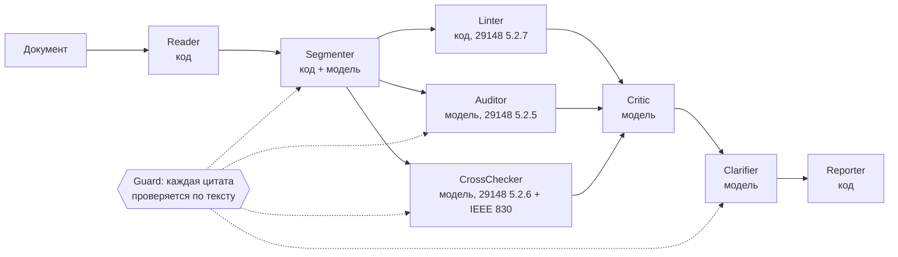

# reqcheck: агент проверки качества требований

AI-агент проводит статическое ревью документа с требованиями до начала разработки: выделяет отдельные
требования, проверяет каждое и весь набор по ISO/IEC/IEEE 29148:2018 (п. 5.2.5, 5.2.6, 5.2.7) и
IEEE 830-1998 (п. 4.3), задаёт автору уточняющие вопросы и пишет отчёт на русском.

Сделано для BCC-HUB x MNU FinTech Hackathon.

## Быстрый старт

Нужен Python 3.11 или новее.

```bash
git clone https://github.com/l9kk/reqcheck && cd reqcheck
python -m venv .venv
. .venv/bin/activate            # Windows: .venv\Scripts\activate
pip install -r requirements.txt
cp .env.example .env            # Windows: copy .env.example .env
```

1. Получите ключ Anthropic: https://platform.claude.com/settings/keys (нужен баланс, около $2 за документ на Opus).
2. Откройте `.env` и вставьте ключ в строку `ANTHROPIC_API_KEY=`. Файл `.env` в git не попадает.
3. Запустите проверку:

```bash
python -m reqcheck input/requirements.md -o report/report.md
```

Отчёт ляжет в `report/`: `report.md` (читаемый отчёт), `report.json` (все данные и трасса агента)
и `report.pdf`. Повторный запуск берёт ответы модели из кэша `.cache/` и не тратит деньги.

Бесплатный вариант: Gemini. Получите ключ https://aistudio.google.com/apikey (войти Google-аккаунтом,
Create API key). В `.env` закомментируйте три строки Anthropic, раскомментируйте блок Gemini и вставьте
ключ в строку `LLM_API_KEY=`.

Демо-режим: `--interactive` после отчёта задаёт 5 главных уточняющих вопросов в терминале
(номер варианта, свой ответ или Enter для варианта по умолчанию) и пишет новые формулировки требований
с критериями приёмки в `report.answers.md`. Официальный отчёт от этого не меняется.

Поддерживаемые форматы входа: `.pdf`, `.md`, `.txt` (UTF-8 и cp1251), `.docx`. Повреждённые и
пустые файлы, сканы без текста, файлы с паролем и не-ТЗ не роняют агента: он пишет отчёт с разделом
«Диагностика» и завершает работу с кодом 2.
Если PDF выгружен со шрифтом без кириллицы (часто в LibreOffice) и слова при чтении слипаются, агент
сам берёт текст через `pdftotext` (poppler), если он установлен, иначе пишет об этом в диагностике.

Презентация: `docs/deck.pdf` (6 слайдов), одна страница: `docs/onepager.pdf`.

Примеры: отчёт на втором ТЗ `examples/autotopup/`, на третьем (слепом) ТЗ `examples/cashback/`,
отчёты на повреждённых файлах `examples/broken/`.

Коды выхода: 0 - критичных дефектов нет, 1 - найдены критичные дефекты, 2 - документ не удалось проверить.

## Модель

По умолчанию: Claude через официальный SDK `anthropic` (2.8.0, потоковый ответ), `LLM_PROVIDER=anthropic`,
модель `claude-opus-5-5`. Дешевле: `claude-sonnet-5-5`, находок чуть меньше (см. оценку качества ниже).
Бесплатно: Gemini, модель `gemini-3.5-flash` через OpenAI-совместимый endpoint (`LLM_PROVIDER=openai_compat`).
Любой OpenAI-совместимый провайдер (OpenAI, OpenRouter, локальный Ollama) подключается тремя строками
в `.env`, примеры в `.env.example`. Без ключа агент всё равно отработает правила кода и честно напишет
в отчёте, что модель не вызывалась.

Стоимость и время с ключом API на `claude-opus-5-5` (посчитано по числу токенов, $4 / $20 за 1 млн токенов
на входе / выходе). На Sonnet примерно вдвое дешевле.

| Документ | Стоимость | Время |
| :--- | :--- | :--- |
| Выданное ТЗ | около $1.6 | 577 с |
| autotopup | около $1.1 | 402 с |
| cashback | около $2.4 | 946 с |

Как получены отчёты в репозитории. Их сделал тот же код на теге v1.3, но ответы модели шли через Claude Code
по нашей собственной подписке, через локальную замену API. Ответы модели лежат в `.cache/llm`, поэтому запуск
на наших трёх документах с `LLM_PROVIDER=anthropic` и `LLM_MODEL=claude-opus-5-5` воспроизводит отчёты из кэша
(ключ всё равно нужен для проверки при старте, подойдёт любой непустой).
Прогоны через настоящий API с настоящим ключом мы ещё не проверяли.

## Как устроен агент



- **Стандарты как данные.** Все свойства качества лежат в `criteria.toml`; промпты собираются из него,
  каждое замечание ссылается на id критерия.
- **Гибридная нарезка.** Код режет документ на фрагменты с точными номерами строк, модель только решает,
  что из них требования. Поэтому цитаты в отчёте дословные.
- **Защита от галлюцинаций.** Замечание без цитаты, найденной в документе, отбрасывается кодом.
  Противоречие без двух мест в документе отбрасывается. Критик убирает общие и ложные замечания,
  сливает замечания на одну тему и ставит «критично» только настоящим блокерам.
- **Защита от инструкций внутри документа.** Текст документа передаётся модели как данные; команды внутри
  него игнорируются.
- **До 7 запросов к модели на прогон**, повторы при лимитах, кэш ответов.

## Тесты

```bash
python -m unittest tests.test_reader tests.test_pipeline eval.test_score
```

Тесты не требуют ключа (режим `LLM_PROVIDER=mock`). Набор повреждённых файлов: `tests/fixtures/broken/`.

## Оценка качества

`eval/golden.toml` - эталонный список дефектов в выданном документе, составленный вручную.
`python eval/score.py report/report.json` считает полноту (recall) и точность (precision) отчёта.

Результат на выданном документе (40 эталонных дефектов, из них 13 обязательных):

| Прогон | Полнота (авто) | Полнота (ручная проверка) | Критичные | Обязательные | Точность |
| :--- | :--- | :--- | :--- | :--- | :--- |
| **Полный агент, claude-opus-5-5 (v1.3)** | **37/40 (92%)** | **36/40 (90%)** | 6/6 (5 с верной важностью) | 13/13 | 92% |
| Для сравнения: claude-sonnet-5-5 (v1.3) | - | 32/40 (80%) | - | 13/13 | - |
| Для сравнения: gemini-3.5-flash (v1.2) | 27/40 (68%) | 23/40 (58%) | 6/6 (5 с верной важностью) | 13/13 | 97% |
| Только правила кода, без модели | 11/40 (28%) | - | - | 9/13 | 93% |

Второй документ `examples/docs/autotopup.md` (другая предметная область). Эталон `eval/golden_autotopup.toml`
закоммичен до первого прогона агента на этом документе. Эталон потом не менялся, но общие правила
кода дописаны уже после эталона, поэтому прогон не полностью слепой (подробно в `eval/manual_check.md`):

| Прогон | Полнота (авто) | Полнота (ручная проверка) | Критичные | Обязательные | Точность |
| :--- | :--- | :--- | :--- | :--- | :--- |
| **Полный агент, claude-opus-5-5 (v1.3)** | **18/18 (100%)** | **18/18 (100%)** | 4/4 (3 с верной важностью) | 8/8 | 78% |
| Для сравнения: claude-sonnet-5-5 (v1.3) | - | 18/18 (100%) | - | 8/8 | - |
| Для сравнения: gemini-3.5-flash (v1.2) | 15/18 (83%) | 14/18 (78%) | 4/4 | 8/8 | 71% |

Отчёт: `examples/autotopup/report.md`. Команда: `python eval/score.py examples/autotopup/report.json --golden eval/golden_autotopup.toml`.

Третий документ `examples/docs/cashback.md` (слепая проверка). Эталон `eval/golden_cashback.toml` закоммичен
до любого прогона агента на этом документе (0fe31eb):

| Прогон | Полнота (авто) | Полнота (ручная проверка) | Критичные | Обязательные | Точность |
| :--- | :--- | :--- | :--- | :--- | :--- |
| **Полный агент, claude-opus-5-5 (v1.3)** | **20/20 (100%)** | **20/20 (100%)** | 5/5 | 9/9 | 45% |
| Для сравнения: claude-sonnet-5-5 (v1.3) | - | 20/20 (100%) | - | 9/9 | - |

На gemini-3.5-flash этот документ не прогоняли. Точность 45% считает `score.py` (39 из 86 замечаний совпали
с эталоном). Вручную: 70 из 86 замечаний - разные реальные дефекты, 5 повторов, 11 шумных (общие пункты
чек-листа, стиль). 16 из 86 помечены «критично», это завышено.

Отчёт: `examples/cashback/report.md`. Команда: `python eval/score.py examples/cashback/report.json --golden eval/golden_cashback.toml`.

Ручная проверка: `score.py` сопоставляет по строке и ключевому слову, это мягко. Мы проверили каждое
совпадение руками и не засчитали ложные (`eval/manual_check.md`), эталоны при этом не менялись.

Точность: доля замечаний отчёта, которые совпали с эталоном. Несовпавшие замечания перечислены
в выводе `score.py` для ручной проверки: часть из них верные, просто их нет в эталоне.
