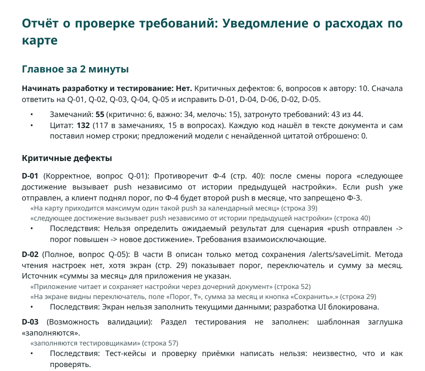
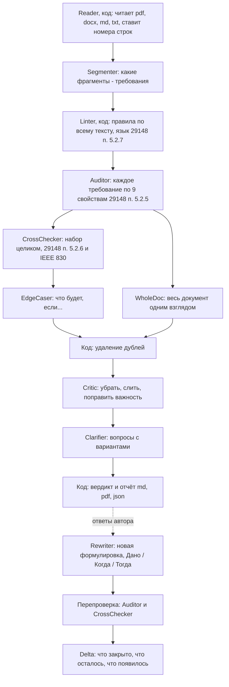

# reqcheck: проверка ТЗ до разработки

Агент читает ТЗ, находит дефекты требований по ISO/IEC/IEEE 29148 и IEEE 830, задаёт автору вопросы
с вариантами ответа и пишет отчёт на русском. Для QA-лида и аналитика: дефекты видны до того, как по ТЗ
начнут писать код и тесты. Каждое замечание с цитатой и номером строки.

**Проверить за 2 минуты:** отчёт на выданном ТЗ [`report/report.md`](report/report.md) (или [PDF](report/report.pdf)),
видео ВИДЕО_URL, презентация [`docs/deck.pdf`](docs/deck.pdf), одностраничник [`docs/onepager.pdf`](docs/onepager.pdf).



*Первый экран отчёта на выданном ТЗ: вердикт и критичные дефекты с цитатами ([`report/report.pdf`](report/report.pdf), стр. 1).*

## Результат на выданном ТЗ

Мы сами составили список из 40 дефектов выданного ТЗ и сверили с ним отчёт агента. Каждое совпадение
открыто и прочитано отдельно, не только по автоматической сверке.

| Что проверяли | Результат |
| :--- | :--- |
| Найдено дефектов из нашего списка | **39 из 40** |
| Критичные дефекты | все 6 распознаны как критичные |
| Замечания агента, которые оказались реальными дефектами | 48 из 55 (87%), ложных 0 |
| Один промпт на той же модели (Claude Opus), 2 прогона | 36 и 34 из 40 |
| Бесплатный Gemini на v1.5 | 29 из 40 (автоматическая сверка, без ручной) |

Ещё одно ТЗ (cashback) мы написали с разметкой до первого прогона: разметка в git 26.11 в 02:10
(коммит 0fe31eb), первый отчёт по нему 27.11 в 03:29 (коммит 80e6f66). Тот первый прогон нашёл 20 из 20
при строгой проверке ([`eval/manual_check.md`](eval/manual_check.md)); v1.5 настраивали уже после этого.

Оговорка: список дефектов наш, независимой оценки нет. Один из 6 критичных (метод называют и сохранением,
и чтением) отмечен как критичный одной фразой в другом замечании. Метод и все числа:
[`eval/handcheck_v1.5.md`](eval/handcheck_v1.5.md), [`docs/details.md`](docs/details.md#результат-подробно).

## Ценность

Главное не в часах ревью: агент ловит дефекты до разработки, на выданном ТЗ все 6 критичных из нашего списка.

| Ценность | Оценка, не замер |
| :--- | :--- |
| Ручная проверка ТЗ на 1 382 слова, один ревьюер | от 0.3 до 2.3 ч и больше по нормам Porter, Wiegers, Gilb; 730-21 800 ₸ |
| Прогон агента на Claude | около 1 040 ₸ ($2.27 по курсу НБ РК 458.85 на 27.11.2026), 13 мин |
| Прогон агента на Gemini, бесплатный ключ | 0 ₸, 5 мин |
| Чтение отчёта человеком | 20-30 мин, около 1 150-1 730 ₸ (допущение) |
| Дефект требований, найденный только на тестах | в 21-78 раз дороже, чем на этапе требований (NASA, 2004) |

На одном коротком ТЗ экономия в деньгах мала. Время живых ревьюеров мы не засекали. Нормы ревью:
[`docs/qa.md`](docs/qa.md#нормы-скорости-ревью-грубый-ориентир-не-замер), расчёт и источники:
[`docs/details.md`](docs/details.md#ценность-в-тенге).

## Что получает QA-лид

Критичный дефект из [`report/report.md`](report/report.md). «Корректное» - свойство требования по
ISO 29148 п. 5.2.5, Ф-3 и Ф-4 - пункты самого ТЗ.

> **D-01** (Корректное, вопрос Q-01): Противоречит Ф-4 (стр. 40): после смены порога «следующее достижение
> вызывает push независимо от истории предыдущей настройки». Если push уже отправлен, а клиент поднял порог,
> по Ф-4 будет второй push в месяце, что запрещено Ф-3.
> > «На карту приходится максимум один такой push за календарный месяц» (строка 39)
> >
> > «следующее достижение вызывает push независимо от истории предыдущей настройки» (строка 40)
>
> Последствия: Нельзя определить ожидаемый результат для сценария «push отправлен → порог повышен → новое
> достижение». Требования взаимоисключающие.

И вопрос к автору, который закрывает этот дефект. У каждого вопроса есть адресат, варианты с тестом
и рекомендация.

> **Q-01** (бизнес; закрывает D-01, D-16, D-33): Ф-3 (стр. 39) и Ф-4 (стр. 40) противоречат друг другу.
> Push в месяце уже отправлен, клиент повысил порог, и расходы достигли нового порога. Отправляется ли
> второй push в том же календарном месяце?
>
> - (а) Нет: признак отправки хранится на пару «карта + месяц» и при смене порога не сбрасывается. Тест:
>   push 10.01 при пороге 50 000 ₸, порог изменён на 80 000 ₸, расходы дошли до 80 000 ₸, второго push в январе нет.
> - (б) Да: сохранение порога с другим значением сбрасывает признак, сохранение того же значения не
>   сбрасывает. Если накопленная сумма уже ≥ нового порога, push не отправляется до следующего месяца.
>   Тест: тот же сценарий даёт второй push в январе при 80 000 ₸.
> - (в) Да, без условий: любое сохранение через saveLimit, включая тот же порог, сбрасывает признак.
>   Тест: повторное сохранение 50 000 ₸ и следующая покупка дают второй push.
>
> Рекомендация агента: Вариант 2. Он сохраняет смысл Ф-4 «независимо от истории» и не даёт получить
> лишний push повторным сохранением того же порога. Ф-3 нужно переформулировать как «один push на
> значение порога в месяц».

Всего в отчёте 55 замечаний, 132 цитаты и 10 вопросов, три главных вопроса стоят на первом экране.

## Быстрый старт


Повтор нашего прогона без ключа: ответы модели из кэша `.cache/llm`, 0 запросов. Нужен Python 3.11+.

```bash
git clone https://github.com/l9kk/reqcheck && cd reqcheck
python -m venv .venv && . .venv/bin/activate && pip install -r requirements.txt   # Windows: .venv\Scripts\activate
python -m reqcheck input/requirements.md -o out/report.md
```

Отчёт ляжет в `out/report.md`, рядом `out/report.pdf` и `out/report.json`.

Свой прогон с ключом. Скопируйте `.env.example` в `.env` (ключ кладётся туда, в git `.env` не попадает).

- **Бесплатно, Gemini.** Ключ: https://aistudio.google.com/apikey (Create API key). В `.env` закомментируйте
  три строки Anthropic, раскомментируйте блок Gemini и вставьте ключ в `LLM_API_KEY=`. Модель `gemini-3.5-flash`.
  Запуск: `python -m reqcheck input/requirements.md -o out/gemini/report.md`
- **Anthropic.** Ключ: https://platform.claude.com/settings/keys (нужен баланс). Вставьте его
  в `ANTHROPIC_API_KEY=`. Модель по умолчанию `claude-opus-5-5`. Без `--no-cache` агент повторит отчёт из кэша.
  Запуск: `python -m reqcheck input/requirements.md -o out/opus/report.md --no-cache`

На входе `.pdf`, `.docx`, `.md` или `.txt`. Другие провайдеры, коды выхода и проверка без сети:
[`docs/details.md`](docs/details.md#как-посмотреть-от-готовых-отчётов-к-своему-прогону).

## Как работает



Роли с пометкой «код» работают без модели. На выданном ТЗ 8 вызовов модели.

- **Цитаты проверяет код.** Каждую цитату модели код ищет в тексте ТЗ и сам ставит номер строки. Не нашёл -
  цитата выброшена, замечание без цитат тоже (`reqcheck/ground.py`).
- **Критерии - это данные.** Свойства 29148 и IEEE 830 лежат в `criteria.toml`, промпты собираются из него.
- **Проверка формы ответа.** Если JSON роли не той формы, код один раз спрашивает роль заново
  (`reqcheck/pipeline.py:270-276`). Вердикт считает код, а не модель.
- **Кэш.** Каждый ответ модели сохраняется в `.cache/llm`, повтор того же прогона не тратит запросов.

Конвейер против одного сильного промпта на той же модели, выданное ТЗ (найдено 39 против 36 и 34 из 40):

| | Конвейер | Один промпт |
| :--- | :--- | :--- |
| Замечаний, совпавших с нашим списком (авто-сверка) | 89% | 93% и 97% |
| Вопросы с вариантами и рекомендацией | да | нет |
| Цикл ответов с перепроверкой | да | нет |
| Вызовов модели, цена по токенам | 8, около $2.3 | 1, $0.34 и $0.26 |

Промпт писали после чтения нашего списка дефектов, сравнение скорее в его пользу ([`eval/baseline/`](eval/baseline/README.md)).

## Цикл ответов

Ответы даются файлом (`--answers`) или в терминале (`--interactive`). [Пример на 10 ответах](examples/answers/requirements.report.answers.md):

- Переписано 25 требований, перепроверка заняла 4 вызова модели.
- Критичных на изменённых требованиях было 5, стало 4: ответы закрыли критичные D-04 и D-05, появилось
  новое критичное N-58.
- Закрыто 7 из 21 связанного замечания, появилось 19 новых. Это последствия ответов, их видно до разработки.

## Ограничения

- Список дефектов составили мы сами. Строго проверено только выданное ТЗ, независимой оценки нет.
- Агент строг: даже почти чистый документ получает вердикт «Нет» (1 критичное и 41 важное). Примера с «Да» нет.
- 5 из 10 вопросов на выданном ТЗ спорят с исправлениями в замечаниях или друг с другом. Отчёт помечает
  такие исправления «окончательно после ответа на Q-xx».
- Один прогон на документ: разброс между прогонами не мерили. Экономию времени тоже не мерили.
- ТЗ уходит во внешний API модели, маскирования персональных данных нет. На локальной модели не проверяли.

## Подробнее

- Как сделаны отчёты в репозитории: модель `claude-opus-5-5` через подписку Claude Code (локальный прокси),
  потом повтор из кэша. [Подробно](docs/details.md#как-сделаны-отчёты-в-репозитории).
- Все детали, запуск, тесты, [все ограничения](docs/details.md#ограничения-и-известные-промахи): [`docs/details.md`](docs/details.md). Оценка: [`eval/`](eval/).
- Отчёт на выданном ТЗ: [`report/report.md`](report/report.md), [`report.pdf`](report/report.pdf), [`report.json`](report/report.json).
- Вопросы жюри и честные ответы: [`docs/qa.md`](docs/qa.md).
- Одностраничник: [`docs/onepager.pdf`](docs/onepager.pdf). Презентация: [`docs/deck.pdf`](docs/deck.pdf).
- Ещё отчёты: [`examples/`](examples/) (два наших ТЗ, бесплатный Gemini, битые файлы, ТЗ с инструкциями для модели).
