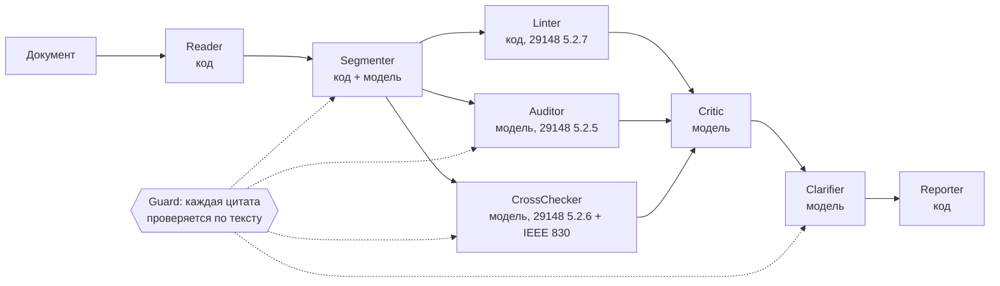

# reqcheck: агент проверки качества требований

AI-агент проводит статическое ревью документа с требованиями до начала разработки: выделяет отдельные
требования, проверяет каждое и весь набор по ISO/IEC/IEEE 29148:2018 (п. 5.2.5, 5.2.6, 5.2.7) и
IEEE 830-1998 (п. 4.3), задаёт автору уточняющие вопросы и пишет отчёт на русском.

Сделано для BCC-HUB x MNU FinTech Hackathon.

## Быстрый старт

Нужен Python 3.11 или новее.

```bash
git clone <ссылка на репозиторий> && cd reqcheck
python -m venv .venv
. .venv/bin/activate            # Windows: .venv\Scripts\activate
pip install -r requirements.txt
cp .env.example .env            # Windows: copy .env.example .env
```

1. Получите бесплатный ключ Gemini: https://aistudio.google.com/apikey (войти Google-аккаунтом, Create API key).
2. Откройте `.env` и вставьте ключ в строку `LLM_API_KEY=`. Файл `.env` в git не попадает.
3. Запустите проверку:

```bash
python -m reqcheck input/requirements.md -o report/report.md
```

Отчёт ляжет в `report/`: `report.md` (читаемый отчёт), `report.json` (все данные и трасса агента)
и `report.pdf`. Повторный запуск берёт ответы модели из кэша `.cache/` и не тратит квоту.

Поддерживаемые форматы входа: `.pdf`, `.md`, `.txt` (UTF-8 и cp1251), `.docx`. Повреждённые и
пустые файлы, сканы без текста, файлы с паролем и не-ТЗ не роняют агента: он пишет отчёт с разделом
«Диагностика» и завершает работу с кодом 2.

Коды выхода: 0 - критичных дефектов нет, 1 - найдены критичные дефекты, 2 - документ не удалось проверить.

## Модель

По умолчанию: Gemini через OpenAI-совместимый endpoint, модель указана в `.env.example`.
Любой OpenAI-совместимый провайдер (OpenAI, OpenRouter, локальный Ollama) подключается тремя строками
в `.env`. Без ключа агент всё равно отработает правила кода и честно напишет в отчёте, что модель не вызывалась.

## Как устроен агент



- **Стандарты как данные.** Все свойства качества лежат в `criteria.toml`; промпты собираются из него,
  каждое замечание ссылается на id критерия.
- **Гибридная нарезка.** Код режет документ на фрагменты с точными номерами строк, модель только решает,
  что из них требования. Поэтому цитаты в отчёте дословные.
- **Защита от галлюцинаций.** Замечание без цитаты, найденной в документе, отбрасывается кодом.
  Противоречие без двух мест в документе отбрасывается. Критик убирает общие и ложные замечания.
- **Защита от инструкций внутри документа.** Текст документа передаётся модели как данные; команды внутри
  него игнорируются.
- **До 7 запросов к модели на прогон**, повторы при лимитах, кэш ответов.

## Тесты

```bash
python -m unittest tests.test_reader tests.test_pipeline eval.test_score
```

Тесты не требуют ключа (режим `LLM_PROVIDER=mock`). Набор повреждённых файлов: `tests/fixtures/broken/`.

## Оценка качества

`eval/golden.toml` - эталонный список дефектов в выданном документе, составленный вручную.
`python eval/score.py report/report.json` считает полноту (recall) и точность (precision) отчёта.
