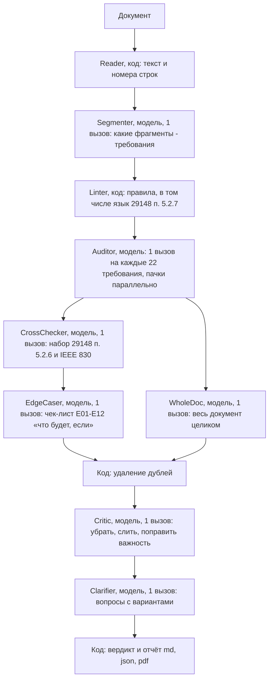

# reqcheck: агент проверки качества требований

Агент читает ТЗ до начала разработки и по каждому требованию показывает, какие свойства ISO/IEC/IEEE 29148
нарушены, с цитатой и номером строки, а затем задаёт автору вопросы с вариантами ответа.

Результат на выданном ТЗ, это самопроверка: список из 40 дефектов (13 обязательных) составили мы сами
(`eval/golden.toml`). Агент нашёл 37 из 40 при строгой проверке и все 13 обязательных. При той же проверке все
149 цитат отчёта сверены с документом и совпали. Отчасти это заслуга кода: цитату, которой нет в документе, он
заменяет строкой документа или выбрасывает.

Сделано для BCC-HUB x MNU FinTech Hackathon. Стандарты: ISO/IEC/IEEE 29148:2018 п. 5.2.5, 5.2.6, 5.2.7 и
IEEE 830-1998 п. 4.3. Все критерии лежат в `criteria.toml`, промпты собираются из него.

## Как посмотреть: от готовых отчётов к своему прогону

### 1. Готовые отчёты, ничего не запуская

- Выданное ТЗ: [`report/report.md`](report/report.md) (также `report.pdf` и `report.json` со всеми данными и трассой).
- Второе ТЗ (написали мы сами): [`examples/autotopup/report.md`](examples/autotopup/report.md).
- Третье ТЗ (написали мы сами): [`examples/cashback/report.md`](examples/cashback/report.md).
- Цикл «ответы на вопросы, новая формулировка, перепроверка»: [`examples/answers/`](examples/answers/).
- Повреждённые файлы (сделаны на v1.2): [`examples/broken/`](examples/broken/).

Первый экран каждого отчёта: вердикт, критичные дефекты с цитатами и главные вопросы к автору.

### 2. Повтор без ключа, 0 запросов к модели

Нужен Python 3.11 или новее. Файл `.env` не нужен.

```bash
git clone https://github.com/l9kk/reqcheck && cd reqcheck
python -m venv .venv
. .venv/bin/activate            # Windows: .venv\Scripts\activate
pip install -r requirements.txt
python -m reqcheck input/requirements.md -o out/report.md
```

Ответы модели из настоящего прогона лежат в `.cache/llm` (29 файлов: 8 + 7 + 9 вызовов на три документа и
5 на пример цикла ответов). Агент берёт их из кэша и пишет тот же отчёт: те же 65 замечаний и 10 вопросов.
В паспорте `out/report.md` будет «Запросов к модели: 8, все ответы взяты из кэша прошлого прогона». Ключ
проверяется только перед настоящим запросом, поэтому для повтора ничего задавать не нужно.

Чтобы отдельно убедиться, что сеть не нужна, можно направить API в никуда (Linux, macOS):

```bash
ANTHROPIC_BASE_URL=http://127.0.0.1:9 LLM_MAX_RETRIES=0 python -m reqcheck input/requirements.md -o out/report.md
```

Эти переменные только для такой проверки. Без `LLM_MAX_RETRIES=0` на документе без кэша агент будет повторять
каждый запрос к недоступному адресу, около двух минут на вызов.

Так же повторяются два других документа:

```bash
python -m reqcheck examples/docs/autotopup.md -o out/autotopup/report.md
python -m reqcheck examples/docs/cashback.md -o out/cashback/report.md
```

На другом документе кэша нет. Без ключа агент тогда отработает только правила кода и напишет
в отчёте, что модель не вызывалась.

### 3. Бесплатно: Gemini

Ключ: https://aistudio.google.com/apikey (войти Google-аккаунтом, Create API key).
Скопируйте `.env.example` в `.env` (Windows: `copy .env.example .env`), закомментируйте три строки
Anthropic и раскомментируйте блок Gemini:

```
LLM_PROVIDER=openai_compat
LLM_BASE_URL=https://generativelanguage.googleapis.com/v1beta/openai/
LLM_API_KEY=ваш_ключ
LLM_MODEL=gemini-3.5-flash
```

```bash
python -m reqcheck input/requirements.md -o out/gemini/report.md
```

На v1.2 `gemini-3.5-flash` нашёл 23 из 40 при строгой проверке (`git show v1.3:eval/manual_check.md`,
строка 9). На v1.4 Gemini не мерили, поэтому с Opus на v1.4-rc1 (37 из 40) это число напрямую не сравнить.
Если кончится дневная квота, агент напишет это в разделе «Диагностика».

### 4. Anthropic (на этой модели сделаны отчёты в репозитории)

Ключ: https://platform.claude.com/settings/keys (нужен баланс). В `.env` оставьте блок Anthropic и вставьте
ключ в `ANTHROPIC_API_KEY=`. Модель по умолчанию `claude-opus-5-5`.

```bash
python -m reqcheck input/requirements.md -o out/opus/report.md --no-cache
```

Без `--no-cache` на наших трёх документах агент просто повторит отчёт из кэша.
На выданном ТЗ прогон занял 611 с и 125 959 / 94 280 токенов (вход / выход, из паспорта отчёта;
прогон шёл через Claude Code, а не через API-ключ, см. «Как сделаны отчёты»).

Форматы входа: `.pdf`, `.md`, `.txt` (UTF-8 и cp1251), `.docx`.

Коды выхода (`reqcheck/cli.py:107-111`):

- 2 - файл не прочитан (нет файла, пустой, битый, зашифрованный, скан без текста), документ не похож на ТЗ
  (по правилам кода или по ответу модели), внутренняя ошибка агента или ошибка в файле `--answers`;
- 1 - в отчёте есть критичные замечания;
- 0 - критичных замечаний нет.

Нет ключа, кончилась квота или не ответила сеть - это не код 2. Агент пишет отчёт по тому, что успел (часто
только правила кода), и выходит с 0 или 1. Поэтому в CI проверяйте в `report.json` поле `verdict.status` и
записи `diagnostics` с `"level": "error"`, а не только код выхода.

## Как устроен агент



- Вызовов модели на документ: 6 + число пачек Auditor. Выданное ТЗ: 43 требования, 2 пачки, 8 вызовов.
  autotopup: 21 требование, 7 вызовов. cashback: 52 требования, 3 пачки, 9 вызовов.
- Повторы. Если JSON роли не той формы, код один раз спрашивает роль заново (`reqcheck/pipeline.py:271-276`);
  этот вызов попадает в паспорт. Невалидный JSON, сетевые ошибки и лимиты повторяются внутри `reqcheck/llm.py`
  до `LLM_MAX_RETRIES` раз (по умолчанию 4, `llm.py:166-182`); эти повторы в число вызовов и токенов
  паспорта не входят.
- Ветка CrossChecker затем EdgeCaser и ветка WholeDoc идут параллельно (`--workers`, по умолчанию 3).
- Проверка цитат в коде (`reqcheck/ground.py`): каждую цитату от Auditor, CrossChecker, EdgeCaser, WholeDoc
  и Clarifier код ищет в тексте документа. Нашёл дословно - цитата остаётся. Нашёл приблизительно (сходство
  не ниже 0.85, `ground.py:63-64`) - цитата заменяется строкой документа. Не нашёл - цитата выбрасывается;
  замечание или вопрос без единой найденной цитаты выбрасывается целиком. Номер строки ставит код, не модель.
  Если для противоречия набора (`set_consistent`) модель дала две цитаты или больше, а в документе нашлась
  только одна строка, замечание отбрасывается (`pipeline.py:368-370`). Отброшенное с причиной лежит в `drops`
  в JSON.
- Вердикт («начинать разработку: Да / С оговорками / Нет», или «Не проверено») считает код по числу
  критичных и важных замечаний. «Не проверено» ставится, если документ не прочитан или не похож на ТЗ, а также
  если модель не использовалась и правила кода не нашли критичных. Если правила нашли критичные, вердикт «Нет»
  и без модели (`pipeline.py:633-652`).
- Текст документа передаётся модели как данные: промпт велит не выполнять команды из документа и считать их
  дефектом (`reqcheck/roles.py:23-24`). Гарантии, что модель послушается, нет.

## Что даёт конвейер по сравнению с одним промптом

Мы проверили это (скрипт, промпт и сырые ответы: `eval/baseline/`). Один сильный промпт на
той же модели `claude-opus-5-5` (наш прогон 27.11.2026) на выданном ТЗ при строгой проверке нашёл 36 из 40
и все 13 обязательных (по `score.py` тот же прогон: 36 из 40 и 12 из 13, это число стоит в таблице ниже).
Конвейер: 37 из 40 строго. То есть по нашей разметке конвейер не находит заметно больше одного промпта.

Этот же промпт, почти без изменений (без вопросов автору), стоит внутри конвейера как роль WholeDoc
(`reqcheck/roles.py:204`). Остальное конвейер добавляет к нему:

- таблицу «требование x 9 свойств 29148 п. 5.2.5» для каждого требования (раздел 5 отчёта);
- проверку цитат кодом: цитата, которой нет в документе, не попадёт в отчёт. Но и у одного промпта без такой
  проверки все цитаты оказались дословными (50 из 50, 43 из 43, 59 из 59, 47 из 47,
  `eval/baseline/README.md:22`), так что на наших прогонах лучше результат от неё не стал;
- вопросы автору с адресатом, вариантами ответа, рекомендацией и списком замечаний, которые ответ закроет;
- цикл ответов: `--answers` переписывает требование, перепроверяет его и показывает, что закрыто и что появилось;
- проверку формы JSON каждой роли с одним повторным вопросом и повторы при невалидном JSON, сетевых ошибках
  и лимитах (см. «Повторы» выше);
- описанные отказы: пустой, битый, зашифрованный файл, скан без текста, не ТЗ, нет ключа, кончилась
  квота. Агент не падает, а пишет раздел «Диагностика». Какие из них дают код выхода 2, см. «Коды выхода».

### Вклад ролей

<!-- ABLATION -->

Таблица посчитана повтором из `.cache/llm`, без новых запросов к модели (`python -m eval.ablation`, подробно
в [`eval/ablation.md`](eval/ablation.md)). Совпадения считает `score.py`, без строгой проверки.
В ячейке: замечаний / найдено дефектов разметки / найдено обязательных.

| Вариант | Выданное ТЗ | autotopup | cashback |
| :--- | :--- | :--- | :--- |
| Только правила (Linter) | 14 / 11/40 / 9/13 | 9 / 7/18 / 4/8 | 3 / 2/20 / 1/9 |
| + Auditor | 88 / 35/40 / 13/13 | 50 / 17/18 / 8/8 | 78 / 19/20 / 8/9 |
| + CrossChecker/EdgeCaser | 110 / 37/40 / 13/13 | 64 / 18/18 / 8/8 | 104 / 20/20 / 9/9 |
| + WholeDoc (все ветки, до Критика) | 140 / 39/40 / 13/13 | 89 / 18/18 / 8/8 | 131 / 20/20 / 9/9 |
| Полный (после Критика = закоммиченный report.json) | 65 / 38/40 / 13/13 | 41 / 18/18 / 8/8 | 79 / 20/20 / 9/9 |
| Один промпт, без конвейера (claude-opus-5-5, 27.11.2026) | 30 (29) / 36/40 (35/40) / 12/13 (13/13) | 26 / 18/18 / 8/8 | 33 / 19/20 / 8/9 |

Оговорки:

- Ряды до Критика - срезы одного прогона, собранные кодом конвейера из ответов ролей в кэше, а не отдельные
  прогоны. Критик на них не запускался. EdgeCaser получает на вход замечания предыдущих ролей, без них его
  ответ был бы другим. Ряды без Критика или без проверки цитат без новых запросов не построить, их нет.
- Число замечаний до Критика включает дубли и ложные срабатывания. По числу замечаний сравнимы только ряды
  «Полный» и «Один промпт».
- Критик сливает похожие замечания, поэтому дефект, найденный только слитым замечанием, может перестать
  совпадать автоматически (на выданном ТЗ после Критика выпал G33).
- Ряд «Один промпт» взят из `eval/baseline/README.md` (27.11.2026); в скобках второй прогон того же промпта
  на выданном ТЗ. Числа в нём тоже по `score.py`. При строгой проверке первый прогон дал 36/40 и 13/13
  обязательных, это число в тексте выше.
- Полностью слепого столбца нет. Один промпт написан после чтения разметки выданного ТЗ (`eval/golden.toml`) и
  подсказывает, где обычно бывают дефекты; разметку autotopup и cashback до его прогона не читали. Но конвейер
  v1.4 (роль WholeDoc, промпты, Критик) меняли уже после того, как были известны его результаты на всех трёх
  документах, в том числе на cashback. На cashback один промпт пропустил 1 обязательный дефект (метода отказа
  от кэшбэка нет в API). Это одна разница на одном документе, вывода о преимуществе из неё мы не делаем.

## Уточнение: вопросы и цикл ответов

Пример вопроса из `report/report.md`:

> **Q-02** (бизнес; закрывает D-02, D-15, D-25, D-19): Ф-3 и Ф-4 противоречат друг другу. Какое правило
> главнее: лимит одного push за месяц или push после смены порога?
> Варианты: (а) Лимит главнее. ... смена порога признак отправки не сбрасывает.; (б) Смена порога сбрасывает
> признак отправки ...; (в) Сброс признака и при смене порога, и при падении расходов ниже порога после возврата.
> Рекомендация агента: Второй вариант: так сохраняется смысл Ф-4. ...

Ответы можно дать в терминале (`--interactive`) или файлом:

```bash
python -m reqcheck input/requirements.md -o out/report.md --answers examples/answers/requirements.answers.toml
```

Формат файла: `Q-01 = "a"` (буква варианта), `"default"` (рекомендация агента) или свой текст. Нужна модель:
роль Rewriter пишет новую формулировку и критерии приёмки, затем Auditor и CrossChecker перепроверяют
переписанные и соседние требования, роль Delta сверяет старые и новые замечания. Результат:
`out/report.answers.md`. Официальный отчёт не меняется.

Настоящий пример: [`examples/answers/requirements.report.answers.md`](examples/answers/requirements.report.answers.md).
Он сделан на отчёте до v1.4-rc1, поэтому номера Q и D в нём не совпадают с текущим `report/report.md`.
Что в нём видно:

- Ответ на вопрос о Ф-3 и Ф-4: «один push в месяц». Агент переписал 5 связанных требований, в том числе
  Ф-3 и Ф-4, с критериями приёмки в форме «Дано, Когда, Тогда».
- При перепроверке закрыто 6 из 13 связанных замечаний, 7 осталось, причина указана у каждого.
- Появилось 11 новых замечаний, это последствия ответов. Например, новый критерий приёмки говорит
  «проведена покупка», а ответ на другой вопрос относит расходы к моменту авторизации.
- Перепроверка: 4 вызова модели, плюс 1 вызов Rewriter до неё.

## Оценка («самопроверка»)

Разметку дефектов (`eval/golden*.toml`) писали мы сами, поэтому это самопроверка, а не внешняя оценка.
`python eval/score.py report/report.json` сопоставляет замечания с разметкой по строке и ключевому слову.
Строгая проверка: каждое совпадение открыто и прочитано отдельным агентом, разметка не менялась ([`eval/handcheck_v1.4.md`](eval/handcheck_v1.4.md)).

| Документ | Дефектов в разметке | Найдено, score.py | Найдено, строго | Обязательные | Вызовов | Время |
| :--- | :--- | :--- | :--- | :--- | :--- | :--- |
| Выданное ТЗ | 40 | 38 | 37 | 13/13 | 8 | 611 с |
| autotopup | 18 | 18 | не проверяли | 8/8 | 7 | 389 с |
| cashback | 20 | 20 | не проверяли | 9/9 | 9 | 675 с |

- Выданное ТЗ, точность при строгой проверке: 60 из 65 замечаний (92%) - реальные дефекты, 1 повтор,
  4 малополезных, неверных 0. По `score.py` 56 из 65 совпали с разметкой.
- autotopup: `score.py` 35 из 41. Разметка закоммичена до первого прогона, но общие правила кода дописаны
  позже тем же человеком, поэтому прогон не полностью независимый (`eval/manual_check.md`).
- cashback: `score.py` 40 из 79. Разметка закоммичена до любого прогона агента (0fe31eb). Промпты потом
  менялись, разметка нет.
- Стресс-набор из 8 документов (длинный, английский, казахский, инъекция, не ТЗ, чистый, docx и pdf) с
  ключами от отдельного агента пока не в репозитории, результатов по нему здесь нет.

Команды для двух других документов:

```bash
python eval/score.py examples/autotopup/report.json --golden eval/golden_autotopup.toml
python eval/score.py examples/cashback/report.json --golden eval/golden_cashback.toml
```

## Сколько времени это экономит (оценка)

По опубликованным нормам скорости инспекций (NASA-STD-8739.9, Wiegers 1995, Gilb 2009) одному внимательному
ревьюеру на документ такого объёма (около 200 строк, 5-7 страниц) нужно примерно от 35 до 300 минут,
около 90 как средняя оценка. Это оценка по литературе, а не замер нашей команды. Агент на выданном ТЗ работал 611 с. Время, чтобы человек
проверил замечания агента, мы не мерили, и из оценки оно не вычтено.

## Как сделаны отчёты в репозитории

Отчёты сделаны кодом тега v1.4-rc1 на модели `claude-opus-5-5` 27.11.2026, без кэша (в паспорте 0 ответов
из кэша). Запросы к модели шли через локальный Claude Code CLI с той же моделью, а не через API-ключ.
Тег v1.4 меняет только первый экран отчёта (по 2 цитаты у критичного дефекта); отчёты перерисованы из тех
же `report.json`. Ответы модели лежат в `.cache/llm`. Код написан после выдачи задания с помощью
AI-инструментов, это разрешено правилами; история коммитов открыта.

## Тесты

```bash
python -m unittest tests.test_reader tests.test_pipeline tests.test_report_md eval.test_score tests.test_loop eval.test_ablation
```

118 тестов, ключ не нужен: модель подменяет `tests/fake_llm.py`. Среди них повтор из кэша без ключа
и набор повреждённых файлов `tests/fixtures/broken/`.

## Ограничения и известные промахи

- Строгая проверка выданного ТЗ нашла промахи в важности. GET для операции записи (D-43) оценён как
  «важно», а должен быть «критично». Пустые версия, чек-лист и согласующие (D-61) и Content-Type при
  пустом теле (D-63) оценены как «мелочь», а должны быть «важно».
- Не найдено: заглушки вместо ролей и авторов. Найдено частично: где виден «Итог 50 000 ₸» в критерии 1,
  измеримый бизнес-KPI цели.
- По нашей разметке один сильный промпт находит почти столько же. Конвейер тратит больше токенов и времени.
- Один прогон на документ: разброс между прогонами конвейера не измерен.
- autotopup и cashback строго не проверены. На cashback 17 из 79 замечаний помечены «критично», это может
  быть завышено.
- Без модели работают только правила кода, они находят мало (на v1.2: 11 из 40).
- Пример цикла ответов сделан на старом отчёте, его номера не совпадают с текущим.
