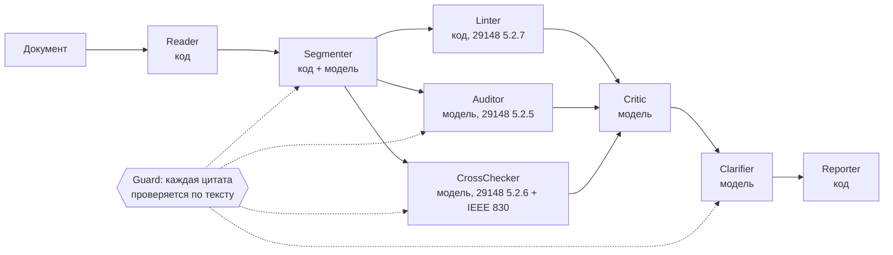

# reqcheck: агент проверки качества требований

AI-агент проводит статическое ревью документа с требованиями до начала разработки: выделяет отдельные
требования, проверяет каждое и весь набор по ISO/IEC/IEEE 29148:2018 (п. 5.2.5, 5.2.6, 5.2.7) и
IEEE 830-1998 (п. 4.3), задаёт автору уточняющие вопросы и пишет отчёт на русском.

Сделано для BCC-HUB x MNU FinTech Hackathon.

## Быстрый старт

Нужен Python 3.11 или новее.

```bash
git clone https://github.com/l9kk/reqcheck && cd reqcheck
python -m venv .venv
. .venv/bin/activate            # Windows: .venv\Scripts\activate
pip install -r requirements.txt
cp .env.example .env            # Windows: copy .env.example .env
```

1. Получите бесплатный ключ Gemini: https://aistudio.google.com/apikey (войти Google-аккаунтом, Create API key).
2. Откройте `.env` и вставьте ключ в строку `LLM_API_KEY=`. Файл `.env` в git не попадает.
3. Запустите проверку:

```bash
python -m reqcheck input/requirements.md -o report/report.md
```

Отчёт ляжет в `report/`: `report.md` (читаемый отчёт), `report.json` (все данные и трасса агента)
и `report.pdf`. Повторный запуск берёт ответы модели из кэша `.cache/` и не тратит квоту.

Демо-режим: `--interactive` после отчёта задаёт 5 главных уточняющих вопросов в терминале
(номер варианта, свой ответ или Enter для варианта по умолчанию) и пишет новые формулировки требований
с критериями приёмки в `report.answers.md`. Официальный отчёт от этого не меняется.

Поддерживаемые форматы входа: `.pdf`, `.md`, `.txt` (UTF-8 и cp1251), `.docx`. Повреждённые и
пустые файлы, сканы без текста, файлы с паролем и не-ТЗ не роняют агента: он пишет отчёт с разделом
«Диагностика» и завершает работу с кодом 2.
Если PDF выгружен со шрифтом без кириллицы (часто в LibreOffice) и слова при чтении слипаются, агент
сам берёт текст через `pdftotext` (poppler), если он установлен, иначе пишет об этом в диагностике.

Примеры: отчёт на втором ТЗ `examples/autotopup/`, отчёты на повреждённых файлах `examples/broken/`.

Коды выхода: 0 - критичных дефектов нет, 1 - найдены критичные дефекты, 2 - документ не удалось проверить.

## Модель

По умолчанию: Gemini через OpenAI-совместимый endpoint, модель `gemini-3.5-flash` (проверена, см. оценку качества ниже).
Любой OpenAI-совместимый провайдер (OpenAI, OpenRouter, локальный Ollama) подключается тремя строками
в `.env`. Без ключа агент всё равно отработает правила кода и честно напишет в отчёте, что модель не вызывалась.

## Как устроен агент



- **Стандарты как данные.** Все свойства качества лежат в `criteria.toml`; промпты собираются из него,
  каждое замечание ссылается на id критерия.
- **Гибридная нарезка.** Код режет документ на фрагменты с точными номерами строк, модель только решает,
  что из них требования. Поэтому цитаты в отчёте дословные.
- **Защита от галлюцинаций.** Замечание без цитаты, найденной в документе, отбрасывается кодом.
  Противоречие без двух мест в документе отбрасывается. Критик убирает общие и ложные замечания.
- **Защита от инструкций внутри документа.** Текст документа передаётся модели как данные; команды внутри
  него игнорируются.
- **До 7 запросов к модели на прогон**, повторы при лимитах, кэш ответов.

## Тесты

```bash
python -m unittest tests.test_reader tests.test_pipeline eval.test_score
```

Тесты не требуют ключа (режим `LLM_PROVIDER=mock`). Набор повреждённых файлов: `tests/fixtures/broken/`.

## Оценка качества

`eval/golden.toml` - эталонный список дефектов в выданном документе, составленный вручную.
`python eval/score.py report/report.json` считает полноту (recall) и точность (precision) отчёта.

Результат на выданном документе (40 эталонных дефектов, из них 13 обязательных):

| Прогон | Полнота (авто) | Полнота (ручная проверка) | Критичные | Обязательные | Точность |
| :--- | :--- | :--- | :--- | :--- | :--- |
| Только правила кода, без модели | 11/40 (28%) | - | - | 9/13 | 93% |
| Полный агент, gemini-3.5-flash | 28/40 (70%) | 24/40 (60%) | 6/6 (5 с верной важностью) | 13/13 | 94% |

Второй документ `examples/docs/autotopup.md` (другая предметная область). Эталон `eval/golden_autotopup.toml`
закоммичен до первого прогона агента на этом документе. Промпты под него не менялись, но общие правила
кода дописаны уже после эталона, поэтому прогон не полностью слепой (подробно в `eval/manual_check.md`):

| Прогон | Полнота (авто) | Полнота (ручная проверка) | Критичные | Обязательные | Точность |
| :--- | :--- | :--- | :--- | :--- | :--- |
| Полный агент, gemini-3.5-flash | 16/18 (89%) | 14/18 (78%) | 4/4 | 8/8 | 81% |

Отчёт: `examples/autotopup/report.md`. Команда: `python eval/score.py examples/autotopup/report.json --golden eval/golden_autotopup.toml`.

Ручная проверка: `score.py` сопоставляет по строке и ключевому слову, это мягко. Мы проверили каждое
совпадение руками и не засчитали ложные (`eval/manual_check.md`), эталоны при этом не менялись.

Точность: доля замечаний отчёта, которые совпали с эталоном. Несовпавшие замечания перечислены
в выводе `score.py` для ручной проверки: часть из них верные, просто их нет в эталоне.
