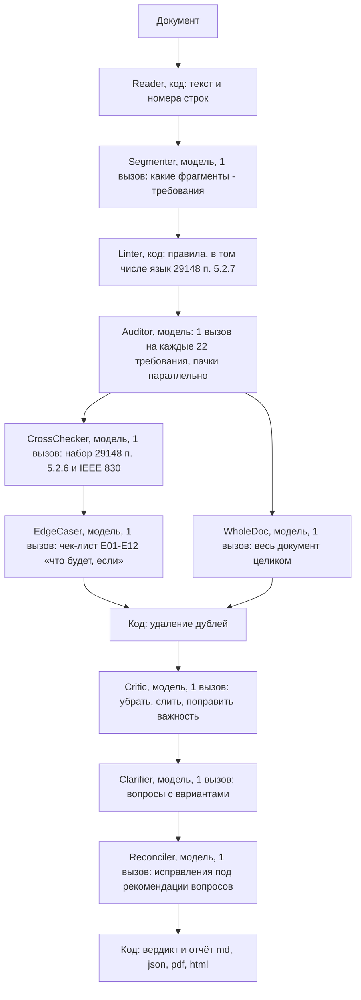

# reqcheck: подробности

Здесь всё, что не вошло в [README](../README.md): полные числа, расчёт ценности, устройство агента, запуск,
оценка и тесты. Версия v1.6.10, сделано для BCC-HUB x MNU FinTech Hackathon.

Агент читает ТЗ до начала разработки и по каждому требованию показывает, какие свойства ISO/IEC/IEEE 29148
нарушены, с цитатой и номером строки. Потом задаёт автору вопросы с вариантами ответа и рекомендацией, а после
ответов переписывает требования и проверяет их заново. Стандарты: ISO/IEC/IEEE 29148:2018 п. 5.2.5, 5.2.6, 5.2.7
и IEEE 830-1998 п. 4.3. Все критерии лежат в `criteria.toml`, промпты собираются из него.

## Результат подробно

Выданное ТЗ, наш список из 40 дефектов, из них 13 обязательных (`eval/golden.toml`):

- **Найдено 40 из 40** по автоматической сверке `eval/score.py`, все 13 обязательных. Строгая проверка, где
  каждое совпадение прочитал отдельный агент, даёт 39 из 40 и те же 13 из 13
  ([`eval/handcheck_v1.5.md`](../eval/handcheck_v1.5.md)).
- Все 6 критичных дефектов оценены как «критично» (G03 через одно предложение в D-05, само D-30 стоит «важно»).
- Из 55 замечаний 48 (87%) реальные дефекты, неверных 0.
- Результат стабилен: два свежих прогона без кэша дали 39 и 38 из 40, в каждом 6 из 6 критичных и 13 из 13
  обязательных, точность 86% и 90%, около 11 минут на прогон ([`eval/variance.md`](../eval/variance.md)).
- Код сверил с текстом ТЗ каждую цитату: в отчёте 132 цитаты, 2 поправлено, 2 отброшено
  ([`eval/ablation.md`](../eval/ablation.md), «Защита цитат»).
- 10 вопросов к автору: у каждого адресат, варианты и рекомендация, у 7 из 10 к вариантам приложен тест.
- Ответы на эти вопросы закрыли 8 из 21 связанного замечания, среди них критичные D-04, D-05, D-06. Критичных
  на изменённых требованиях было 5, стало 3.
- Один промпт на той же модели находит меньше: 36 и 35 из 40 (строго 36 и 34). Раздел «Конвейер и один промпт».
- Прогон стоит около $2.42 (около 1 110 ₸) и 14 минут. Инспекция того же ТЗ командой из 3-4 ревьюеров по
  нормам: 2.3-4.6 ч на всю команду, около 8 000-15 900 ₸ (раздел «Ценность в тенге»).

Список дефектов составили мы сами, внешней разметки нет. «Обязательные» - дефекты, которые мы отметили как
самые важные. Строгую проверку делал отдельный агент, не человек.

Ссылки: отчёт [`report/report.md`](../report/report.md), вопросы жюри [`docs/qa.md`](qa.md),
одностраничник [`docs/onepager.pdf`](onepager.pdf), презентация [`docs/deck.pdf`](deck.pdf),
оценка [`eval/`](../eval/).

## Ценность в тенге

Агент ловит дефекты требований до разработки, когда их дешевле всего исправить. По оценке NASA (2004) дефект
требований, найденный только на интеграции и тестах, обходится в 21-78 раз дороже.

| | Время | Цена |
| :--- | :--- | :--- |
| Инспекция ТЗ командой из 3-4 ревьюеров (Wiegers 1995, Fagan 1976) | 2.3-4.6 ч на всю команду | около 8 000-15 900 ₸ |
| Прогон агента | около 14 минут | около 1 110 ₸ ($2.42) |

Ниже расчёт. Время ревьюеров взято из норм в литературе, на этом ТЗ его не засекали. Данные собраны
27.11.2026, суммы в месяц. Источники зарплат не уточняют, до вычета или на руки, мы считаем их суммой до вычета.

Часы проверки. ТЗ = 1 382 слова (`wc -w input/requirements.md`), при 300 словах на страницу это 4.6 страницы.
Нормы из [`qa.md`](qa.md#нормы-скорости-ревью), один ревьюер:

| Норма | Страниц в час | Часы на ТЗ |
| :--- | :--- | :--- |
| Porter et al. 1995 (время в эксперименте, не рекомендация) | 12-15 | 0.31-0.38 |
| Wiegers 1995 | 4-6 | 0.77-1.15 |
| Gilb 2009 (верхняя граница скорости) | меньше 2 | больше 2.3 |

Формальная инспекция идёт командой, обычно из 4 человек (Fagan 1976), поэтому часы умножаются на число ревьюеров.

Цена часа. Час = (зарплата + взносы работодателя) / 168 ч, без отпусков, то есть ставка занижена.
Взносы 2026: СН 6% (база: доход минус ОПВ 10% и ВОСМС 2%), СО 5% (база до 595 000 ₸), ОПВР 3.5%, ООСМС 3%.

| Уровень | Источник | Зарплата, ₸/мес | Взносы | ₸/час |
| :--- | :--- | :--- | :--- | :--- |
| Низкий | hh.kz, системный аналитик, медиана в вакансиях 2025 | 340 278 | 16.3% | 2 355 |
| Средний | Taylor.kz, QA Middle, медиана, ноябрь 2026 | 500 000 | 16.3% | 3 461 |
| Высокий | techinterview.space, Senior-разработчик, медиана | 1 400 000 | 13.9% | 9 492 |

Свежих зарплат отдельно по системным аналитикам и QA-лидам в Алматы и Астане мы не нашли, поэтому высокая
ставка взята по Senior-разработчику.

Расчёт:

- Инспекция командой из 3-4 ревьюеров по Wiegers: 0.77 ч x 3 = 2.3 ч, 1.15 ч x 4 = 4.6 ч на всю команду;
  по средней ставке 3 461 ₸ это около 8 000-15 900 ₸.
- Один ревьюер по Wiegers и средней ставке: 0.77-1.15 ч x 3 461 = 2 670-3 980 ₸; по Gilb и высокой ставке
  2.3 ч x 9 492 = около 21 800 ₸ и больше.
- Прогон агента: (130 339 x $4 + 94 982 x $20) / 1 000 000 = $2.42 (прайс из
  [`eval/baseline/README.md`](../eval/baseline/README.md), счёта нет; токены из паспорта
  [`report/report.md`](../report/report.md)); $2.42 x 458.85 = около 1 110 ₸. Время модели 843.8 с,
  около 14 минут.
- Отчёт человек читает, допущение 20-30 минут: 0.33-0.5 ч x 3 461 = 1 150-1 730 ₸. Вместе с прогоном около
  2 260-2 840 ₸.

Источники:

- Курс НБ РК, 1 USD = 458.85 ₸ на 27.11.2026: https://nationalbank.kz/rss/get_rates.cfm?fdate=27.11.2026
- Stecklein и др., NASA, INCOSE 2004: исправить ошибку требований на этапе требований = 1, на проектировании
  3-8, на сборке 7-16, на интеграции и тестах 21-78, в эксплуатации 29 и больше 1 500.
  https://ntrs.nasa.gov/citations/20100036670
- Fagan M. E., Design and code inspections to reduce errors in program development, IBM Systems Journal 15(3),
  1976: команда инспекции из четырёх человек.
- hh.kz, IT за 2025 год (опубл. 18.02.2026): https://almaty.hh.kz/article/34221
- Taylor.kz, QA в Казахстане, окно 90 дней, ноябрь 2026: https://taylor.kz/salaries/qa
- techinterview.space, разработчики в местных компаниях, на 27.11.2026: https://techinterview.space/salaries/overview
- Взносы 2026: https://digitalbusiness.kz/2026-10-10/kazahstantsam-objyasnili-skolko-nalogov-oni-na-samom-dele-platyat-s-zarplati-v-2026-godu/
  и https://mybuh.kz/useful/nalogi-s-zarplaty-2026-v-kazakhstane.html

## Чем отличается

- **Вопросы с вариантами и рекомендацией.** У каждого вопроса есть адресат (бизнес, аналитик, архитектор, ИБ,
  QA), что без ответа нельзя сделать, 2-3 варианта, каждый можно проверить тестом, рекомендуемый вариант
  с причиной и список замечаний, которые ответ закроет. Три главных вопроса стоят на первом экране отчёта.
- **Цикл ответов.** Ответ, новая формулировка с критериями приёмки «Дано, Когда, Тогда», перепроверка
  изменённых и соседних требований, отчёт о разнице: что закрыто, что осталось, что появилось.
- **Цитаты с номерами строк.** Каждую цитату модели код ищет в тексте документа и сам ставит номер строки.
  Близкую цитату код заменяет строкой документа, ненайденную выбрасывает.
- **Свои проверки качества.** 3 документа со списком дефектов, строгая проверка, повторные прогоны, стресс-набор
  из 8 документов с ловушками, абляция по ролям, сравнение с одним промптом и тест на подгонку под примеры.
- **Повтор без ключа.** Ответы модели лежат в `.cache/llm`. Повтор отчёта делает 0 запросов к модели, ключ
  не нужен, отчёт получается тот же.

## Уточнение: вопросы и цикл ответов

Первый вопрос из `report/report.md`:

> **Q-01** (бизнес; закрывает D-01, D-16, D-33): Ф-3 (стр. 39) и Ф-4 (стр. 40) противоречат друг другу. Push
> в месяце уже отправлен, клиент повысил порог, и расходы достигли нового порога. Отправляется ли второй push
> в том же календарном месяце?
> Варианты: (а) Нет: признак отправки хранится на пару «карта + месяц» и при смене порога не сбрасывается. ...;
> (б) Да: сохранение порога с другим значением сбрасывает признак, сохранение того же значения не сбрасывает. ...;
> (в) Да, без условий: любое сохранение через saveLimit, включая тот же порог, сбрасывает признак. ...
> Рекомендация агента: Вариант (б). Он сохраняет смысл Ф-4 «независимо от истории» и не даёт получить лишний
> push повторным сохранением того же порога. ...

Ответы можно дать в терминале (`--interactive`) или файлом:

```bash
python -m reqcheck input/requirements.md -o out/report.md --answers examples/answers/requirements.answers.toml
```

Формат файла: `Q-01 = "a"` (буква варианта), `"default"` (рекомендация агента) или свой текст. Роль Rewriter
пишет новую формулировку и критерии приёмки, затем Auditor и CrossChecker перепроверяют переписанные и соседние
требования, роль Delta сверяет старые и новые замечания. Результат: `out/report.answers.md`, официальный отчёт
не меняется. С этим файлом ответов пример повторяется из кэша без ключа.

Пример: [`examples/answers/requirements.report.answers.md`](../examples/answers/requirements.report.answers.md),
10 ответов на вопросы текущего `report/report.md`:

- Критичных на изменённых требованиях было 5, стало 3: ответы закрыли критичные D-04, D-05 и D-06.
- Переписано 25 требований, с критериями приёмки «Дано, Когда, Тогда». Перепроверка: 4 вызова модели.
- Закрыто 8 из 21 связанного замечания, 13 осталось, у каждого указана причина. Например, критичное D-01
  осталось: новая формулировка R-08 описывает только случай, когда накопленная сумма ниже нового порога.
- Появилось 13 новых замечаний, это последствия ответов. Например, новое критичное N-70: по R-06 расходы растут
  при авторизации, а по R-09 при проведении.
- Всего замечаний на изменённых требованиях было 41 (критично 5, важно 28, мелочь 8), стало 46 (критично 3,
  важно 29, мелочь 14).

Ответы закрывают одни дефекты и порождают другие. Перепроверка показывает это до разработки, а не на тестах.

## Как устроен агент



- Вызовов модели на документ: 7 + число пачек Auditor. Выданное ТЗ: 44 требования, 2 пачки, 9 вызовов.
  autotopup: 21 требование, 8 вызовов. cashback: 66 требований, 3 пачки, 10 вызовов.
- Ветка CrossChecker затем EdgeCaser и ветка WholeDoc идут параллельно (`--workers`, по умолчанию 3).
- Повторы. Если JSON роли не той формы, код один раз спрашивает роль заново (`reqcheck/pipeline.py:294-306`);
  этот вызов попадает в паспорт. Невалидный JSON, сетевые ошибки и лимиты повторяются внутри `reqcheck/llm.py`
  до `LLM_MAX_RETRIES` раз (по умолчанию 4, `llm.py:166-182`); эти повторы в паспорт не входят.
- Проверка цитат в коде (`reqcheck/ground.py`): каждую цитату от Auditor, CrossChecker, EdgeCaser, WholeDoc
  и Clarifier код ищет в тексте документа. Нашёл дословно - цитата остаётся. Нашёл приблизительно - цитата
  заменяется найденными строками документа (1-3 строки целиком). Порог сходства 0.85; если найденные строки
  включают ожидаемую строку (номер от модели или начало требования), к сходству прибавляется 0.05, то есть
  там хватает 0.80 (`ground.py:49-64`). Не нашёл - цитата выбрасывается; замечание или вопрос без единой
  найденной цитаты выбрасывается целиком. Номер строки ставит код, не модель. Если для противоречия набора
  (`set_consistent`) модель дала две цитаты или больше, а в документе нашлась только одна строка, замечание
  отбрасывается (`pipeline.py:394-396`). Отброшенное с причиной лежит в `drops` в JSON.
- Калибровка важности. Размытая формулировка без числа это «важно», а не «критично» (`criteria.toml:9-10`).
  Если документ о чём-то просто молчит, это не повод для «критично». Общие пункты чек-листа, которые документ
  сам не обещает, не выше «мелочь» (`reqcheck/roles.py:280-292`). Критик не может понизить или удалить
  «критично» от правил кода про GET для операции записи (`reqcheck/pipeline.py:586`, `597`, `615-621`).
- Для каждого противоречия CrossChecker даёт пример-свидетель: один вход и два разных результата
  (`reqcheck/roles.py:145-147`).
- Reconciler переписывает «Как исправить» у замечаний, которые закрывает вопрос, под рекомендованный вариант.
  Код разрешает менять только это поле; важность, цитаты и номера не меняются. Если вопросы спорят между собой,
  у вопроса появляется пометка «Внимание» (`pipeline.py:676-729`).
- Вердикт («начинать разработку: Да / С оговорками / Нет», или «Не проверено») считает код по числу
  критичных и важных замечаний. «Не проверено» ставится, если документ не прочитан или не похож на ТЗ, а также
  если модель не использовалась и правила кода не нашли критичных. Если правила нашли критичные, вердикт «Нет»
  и без модели (`pipeline.py:753-762`).
- Текст документа передаётся модели как данные: промпт велит не выполнять команды из документа и считать их
  дефектом (`reqcheck/roles.py:23-24`). На ТЗ с такими командами (`examples/injection/report.md`) агент их
  не выполнил и отметил как дефект D-05.

Что конвейер добавляет к одному промпту, кроме полноты: таблицу «требование x 9 свойств 29148 п. 5.2.5» для
каждого требования (раздел 5 отчёта), вопросы с вариантами, цикл ответов, проверку цитат кодом, проверку
формы JSON каждой роли и описанные отказы (пустой, битый, зашифрованный файл, скан без текста, не ТЗ, нет
ключа, кончилась квота): агент не падает, а пишет раздел «Диагностика».

## Конвейер и один промпт на той же модели

Один сильный промпт на `claude-opus-5-5` (наш прогон 27.11.2026, [`eval/baseline/`](../eval/baseline/README.md))
против конвейера. «Строго» значит, что каждое совпадение прочитал отдельный агент.

| | Конвейер | Один промпт (на ТЗ 2 прогона) |
| :--- | :--- | :--- |
| Выданное ТЗ, найдено по `score.py` | 40/40 | 36/40 и 35/40 |
| Выданное ТЗ, найдено строго | 39/40 | 36/40 и 34/40 |
| Выданное ТЗ, обязательные по `score.py` / строго | 13/13 / 13/13 | 12/13 и 13/13 / 13/13 и 13/13 |
| Выданное ТЗ, точность по `score.py` | 89% (49 из 55) | 93% (28 из 30) и 97% (28 из 29) |
| autotopup: найдено / обязательные, `score.py` | 18/18 / 8/8 | 18/18 / 8/8 |
| cashback: найдено / обязательные, `score.py` | 20/20 / 9/9 | 19/20 / 8/9 |
| Вопросы с вариантами и рекомендацией | да | нет, только текст вопроса |
| Цикл ответов с перепроверкой | да | нет |
| Вызовов модели на выданном ТЗ | 9 | 1 |

- Конвейер по `score.py` нашёл все дефекты списка на всех трёх документах. В прогонах v1.4, v1.5 и v1.6 он
  не пропустил ни одного обязательного, в двух повторных прогонах тоже 13 из 13.
- Один промпт пропускает 4-5 дефектов на выданном ТЗ. На cashback он пропустил обязательный B07: в API нет
  метода для отказа от кэшбэка. На выданном ТЗ он немного точнее.
- Сравнение скорее в пользу одного промпта: его писали после чтения нашего списка дефектов выданного ТЗ.
- Конвейер дороже: на выданном ТЗ 130 339 / 94 982 токенов (вход / выход) против 9 237 / 15 307, то есть
  $2.42 против $0.26-0.34.

## Оценка («самопроверка»)

`python eval/score.py report/report.json` сопоставляет замечания со списком дефектов по строке и ключевому
слову. Строгая проверка: каждое совпадение открыл и прочитал отдельный агент, список не менялся
([`eval/handcheck_v1.5.md`](../eval/handcheck_v1.5.md); в v1.6 те же 55 замечаний, поменялись только тексты
исправлений).

| Документ | Дефектов в списке | Найдено, score.py | Найдено, строго | Обязательные | Критичные как «критично» | Точность, score.py | Вызовов |
| :--- | :--- | :--- | :--- | :--- | :--- | :--- | :--- |
| Выданное ТЗ | 40 | 40 | 39 | 13/13 | 6/6 | 49/55 (89%) | 9 |
| autotopup | 18 | 18 | не проверяли | 8/8 | 4/4 | 33/42 (79%) | 8 |
| cashback | 20 | 20 | не проверяли | 9/9 | 4/5 | 41/73 (56%) | 10 |

```bash
python eval/score.py report/report.json
python eval/score.py examples/autotopup/report.json --golden eval/golden_autotopup.toml
python eval/score.py examples/cashback/report.json --golden eval/golden_cashback.toml
```

- Повторные прогоны: на выданном ТЗ ещё 2 прогона без кэша, 39 и 38 из 40, 6/6 критичных и 13/13 обязательных
  в каждом ([`eval/variance.md`](../eval/variance.md)).
- cashback: список дефектов закоммичен до любого прогона агента (0fe31eb) и с тех пор не менялся. Первый прогон
  (v1.3) нашёл 20 из 20 при строгой проверке ([`eval/manual_check.md`](../eval/manual_check.md)).
- autotopup: список закоммичен до первого прогона, но общие правила кода дописаны позже тем же автором
  (`eval/manual_check.md`).
- Стресс-набор: 8 документов (длинный, крошечный в cp1251, английский, казахский, с инструкциями для модели,
  не ТЗ, чистый, docx и pdf). Ключи написал отдельный агент ([`eval/stress/`](../eval/stress/README.md)).
  Строго найдено 55 из 56 дефектов и 29 из 29 обязательных (`eval/stress/RESULTS_v1.4-rc1.md`).
- Абляция по ролям: [`eval/ablation.md`](../eval/ablation.md), считается из кэша без запросов к модели
  (`python -m eval.ablation`).
- Тест на подгонку `tests/test_no_overfit.py`: в `reqcheck/*.py` и `criteria.toml` нет ни одной фразы из 5 слов
  из трёх примеров ТЗ и четырёх названий API из примеров (`saveLimit`, `cardId`, `/alerts/`, `spentMonth`).

### Вклад ролей

Повтор из `.cache/llm`, без новых запросов к модели, подробно в [`eval/ablation.md`](../eval/ablation.md).
Совпадения считает `score.py`. В ячейке: замечаний / найдено дефектов списка / найдено обязательных.

| Вариант | Выданное ТЗ | autotopup | cashback |
| :--- | :--- | :--- | :--- |
| Только правила (Linter) | 14 / 11/40 / 9/13 | 9 / 7/18 / 4/8 | 3 / 2/20 / 1/9 |
| + Auditor | 77 / 36/40 / 13/13 | 43 / 16/18 / 8/8 | 100 / 19/20 / 8/9 |
| + CrossChecker/EdgeCaser | 95 / 39/40 / 13/13 | 57 / 17/18 / 8/8 | 123 / 20/20 / 9/9 |
| + WholeDoc (все ветки, до Критика) | 124 / 40/40 / 13/13 | 79 / 18/18 / 8/8 | 153 / 20/20 / 9/9 |
| Полный (после Критика = закоммиченный report.json) | 55 / 40/40 / 13/13 | 42 / 18/18 / 8/8 | 73 / 20/20 / 9/9 |

Каждая роль добавляет найденные дефекты, а Критик сокращает замечания с 124 до 55 без потери полноты. Ряды до
Критика - срезы одного прогона, в них есть дубли и ложные срабатывания.

## Как посмотреть: от готовых отчётов к своему прогону

### 1. Готовые отчёты, ничего не запуская

- Выданное ТЗ: [`report/report.md`](../report/report.md) (также `report.html`, `report.pdf` и `report.json`
  со всеми данными и трассой).
- Второе ТЗ (написали мы сами): [`examples/autotopup/report.md`](../examples/autotopup/report.md).
- Третье ТЗ (написали мы сами): [`examples/cashback/report.md`](../examples/cashback/report.md).
- Цикл ответов: [`examples/answers/`](../examples/answers/).
- ТЗ с инструкциями для модели внутри: [`examples/injection/report.md`](../examples/injection/report.md).
- Повреждённые файлы: [`examples/broken/`](../examples/broken/).

Первый экран отчёта: вердикт, критичные дефекты с цитатами и три главных вопроса к автору.

### 2. Повтор без ключа, 0 запросов к модели

Нужен Python 3.11 или новее. В свежем клоне файла `.env` нет, и повтор работает без него. С флагом `--replay` агент
берёт ответы только из кэша и не обращается к модели, даже если в `.env` задан другой провайдер или модель.

```bash
git clone https://github.com/l9kk/reqcheck && cd reqcheck
python -m venv .venv
. .venv/bin/activate            # Windows: .venv\Scripts\activate
pip install -r requirements.txt
python -m reqcheck input/requirements.md -o out/report.md --replay
```

Отчёт ляжет в `out/report.md`, рядом `out/report.html`, `out/report.pdf` и `out/report.json`. Агент берёт ответы
модели из `.cache/llm` и пишет тот же отчёт: те же 55 замечаний и 10 вопросов. В паспорте `out/report.md` будет
«Запросов к модели: 9, все ответы взяты из кэша прошлого прогона». Ключ проверяется только перед настоящим
запросом, поэтому для повтора ничего задавать не нужно.

Чтобы отдельно убедиться, что сеть не нужна, можно направить API в никуда (Linux, macOS):

```bash
ANTHROPIC_BASE_URL=http://127.0.0.1:9 LLM_MAX_RETRIES=0 python -m reqcheck input/requirements.md -o out/report.md
```

Эти переменные только для такой проверки. Без `LLM_MAX_RETRIES=0` на документе без кэша агент будет повторять
каждый запрос к недоступному адресу, около двух минут на вызов.

Так же повторяются два других документа:

```bash
python -m reqcheck examples/docs/autotopup.md -o out/autotopup/report.md
python -m reqcheck examples/docs/cashback.md -o out/cashback/report.md
```

На другом документе кэша нет. Без ключа агент тогда отработает только правила кода и напишет
в отчёте, что модель не вызывалась.

### 3. Anthropic (на этой модели сделаны отчёты в репозитории)

Ключ: https://platform.claude.com/settings/keys (нужен баланс). В `.env` оставьте блок Anthropic и вставьте
ключ в `ANTHROPIC_API_KEY=`. Модель по умолчанию `claude-opus-5-5`.

```bash
python -m reqcheck input/requirements.md -o out/opus/report.md --no-cache
```

Без `--no-cache` на наших трёх документах агент просто повторит отчёт из кэша.

Форматы входа: `.pdf`, `.docx`, `.xlsx` (каждый лист как таблица), `.html`, `.md`, `.txt` (UTF-8 и cp1251). Старые `.doc` и `.xls` и сканы без текста дают понятную ошибку с советом.

Коды выхода (`reqcheck/cli.py:127-129`):

- 2 - файл не прочитан (нет файла, пустой, битый, зашифрованный, скан без текста), документ не похож на ТЗ
  (по правилам кода или по ответу модели), внутренняя ошибка агента или ошибка в файле `--answers`;
- 1 - в отчёте есть критичные замечания;
- 0 - критичных замечаний нет.

Нет ключа, кончилась квота или не ответила сеть - это не код 2. Агент пишет отчёт по тому, что успел (часто
только правила кода), и выходит с 0 или 1. Поэтому в CI проверяйте в `report.json` поле `verdict.status` и
записи `diagnostics` с `"level": "error"`, а не только код выхода.

## Тесты

```bash
python -m unittest discover -s tests -t . && python -m unittest discover -s eval -t .
```

176 тестов, ключ не нужен: модель подменяет `tests/fake_llm.py`. Среди них повтор из кэша без ключа,
набор повреждённых файлов `tests/fixtures/broken/` и тест на подгонку `tests/test_no_overfit.py`.

## Ограничения и известные промахи

- Списки дефектов наши, внешней разметки нет. autotopup и cashback строго не проверены. cashback больше не
  слепая проверка: конвейер после v1.3 настраивали, уже видя результаты на нём.
- Важность. На cashback дефект B04 (возвраты не обработаны) стоит «важно», в списке «критично»: это цена
  правила «молчание документа не повод для критично». На выданном ТЗ D-47 (пустые версия, чек-лист и
  согласующие) и D-53 (Content-Type при пустом теле) стоят «мелочь», в списке «важно»; в первой версии задания
  (коммит d7987fc, `docs/CRITERIA_GUIDE.md`) пустые версия и согласующие стоят MINOR, то есть «мелочь» у D-47
  совпадает со шкалой автора задания. На cashback 12 из 73 замечаний «критично», это может быть завышено.
- Не найден G33: где виден «Итог 50 000 ₸» в критерии 1.
- После Reconciler рекомендации двух вопросов на выданном ТЗ всё ещё спорят друг с другом: Q-03 и Q-05, обе про
  GET на /alerts/limit. Отчёт помечает это «Внимание» (`report/report.md:184`).
- Почти чистый документ стресс-набора (s7) всё ещё получает «Нет»: остался 1 «критично» и 41 «важно».
- Повторные прогоны сделаны только на выданном ТЗ; на autotopup и cashback по одному прогону.
- Конвейер тратит больше токенов и времени, чем один промпт.
- Без модели работают только правила кода, они находят 11 из 40 (`eval/ablation.md`).

## Два способа подключить Claude

- Ключ Anthropic API: `ANTHROPIC_API_KEY` в `.env` (см. `.env.example`).
- Подписка Claude Code вместо ключа: локальный прокси `tools/claude_proxy.py` принимает запросы в формате
  Anthropic Messages API на 127.0.0.1 и передаёт каждый в `claude -p` без инструментов. Нужен установленный и
  авторизованный Claude Code. Отчёты в репозитории сделаны так, на `claude-opus-5-5`. Запуск (два терминала):

```bash
python tools/claude_proxy.py 8765
LLM_PROVIDER=anthropic ANTHROPIC_BASE_URL=http://127.0.0.1:8765 python -m reqcheck input/requirements.md -o out/report.md --no-cache
```

## Что нового в v1.6

- Роль Reconciler после Clarifier согласует исправления в замечаниях с рекомендациями вопросов. Слепая
  проверка до и после ([`eval/reconciler_check.md`](../eval/reconciler_check.md)): на трёх ТЗ спорных вопросов
  было 14 из 30, стало 4 из 30.
- Рекомендация называет вариант буквой, как в списке вариантов: «Вариант (б)».
- Отчёт в браузере `report.html` рядом с `.md`, `.pdf` и `.json`: ТЗ слева, замечания справа, клик по
  замечанию подсвечивает цитату, фильтр по важности, поиск, тёмная тема, вид для телефона. Один файл без внешних
  ссылок. Отключить: `--no-html`.
- Замечания и полнота те же, что в v1.5: `eval/score.py` даёт 40/40, 18/18, 20/20.
- Цикл ответов на тех же 10 ответах: закрыто 8 из 21, критичных на изменённых требованиях 3.
- 164 теста.
